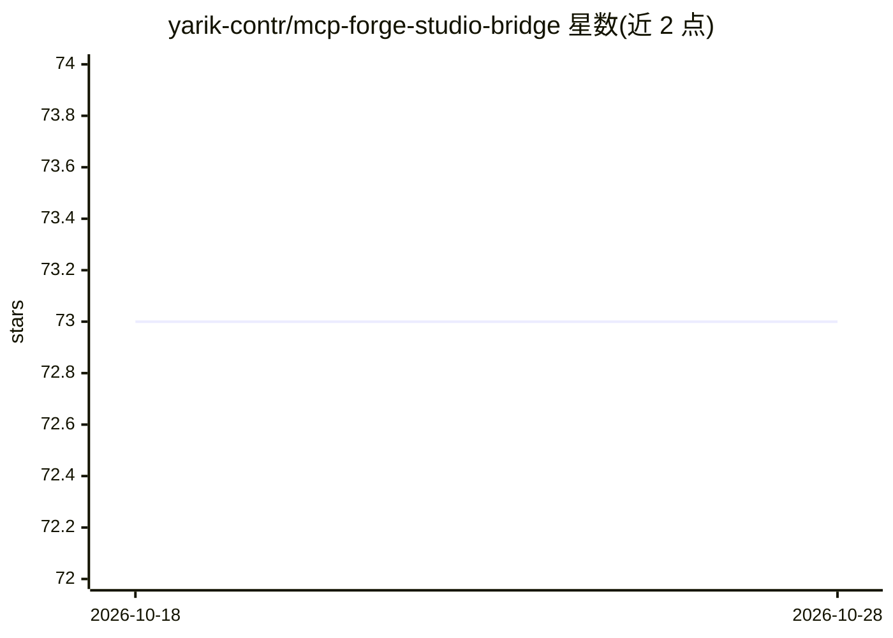

# yarik-contr/mcp-forge-studio-bridge

⭐ 73 · HTML · 推送 2026-10-27 · [GitHub](https://github.com/yarik-contr/mcp-forge-studio-bridge) · 个人维护

**连接 AI 编码助手与 Roblox Studio 的 MCP 服务器及配套插件**

面向 Roblox 开发者的 MCP 服务器与配套 Studio 插件：让 Claude、Cursor、Gemini 等 AI 编码助手直接在 Roblox Studio 会话中执行操作。功能覆盖 Luau 脚本的生成/分析/重构、地形生成（填充/平滑/雕刻/绘制）、资产搜索与按向量精确放置、光照调整，以及项目与 Studio 的双向同步。机制上由插件接收意图、服务器执行脚本调用，AI 可查看执行结果并继续调整。以 GitHub release 形式提供下载，README 未展示具体安装命令与平台细节。

## 筛选速览

| 维度 | 判定 | 备注 |
|---|---|---|
| AI 角色 | `ai-ecosystem` | LLM/agent 周边工具 |
| 许可风险 | `none` | — |
| 部署形态 | `None` |  |
| 模型依赖 | — | README 未给出锁定关系 |
| 硬件要求 | — | 无带数字的原话,不猜 |
| 安装摩擦 | `low` | 无编译、无系统依赖或容器化 |
| 成熟度 | — | 结构信号不足 |

## 能力要点

- Luau 脚本的 AI 生成、分析与重构（感知项目层级结构）
- 自然语言驱动的地形雕刻与生成（山脉/河流/道路）
- 资产搜索与按坐标向量的精确放置
- 项目与 Roblox Studio 的双向同步

## 适用场景

- 用自然语言让 AI 助手在 Studio 中搭建场景与房间
- 让 AI 编写引用现有模块的 Luau 业务脚本
- 通过对话调整场景光照与氛围

## 场景标签

`代码生成` · 领域:编码与开发

## 证据(README 行号)

> L4: # Roblox Studio MCP Server & Plugin
> L6: **AI-powered scripting, terrain, assets, lighting, and bidirectional project sync for your favorite AI coding assist

## 星数曲线

2026-10-18 73 → 2026-10-28 73（+0）

---
*卡片 v1 · prompt 1.4 · 生成 2026-10-24 · 置信度 high · 依据 README sha `e500a59ef9d3` · [字段定义](../../DATASET.md)*
