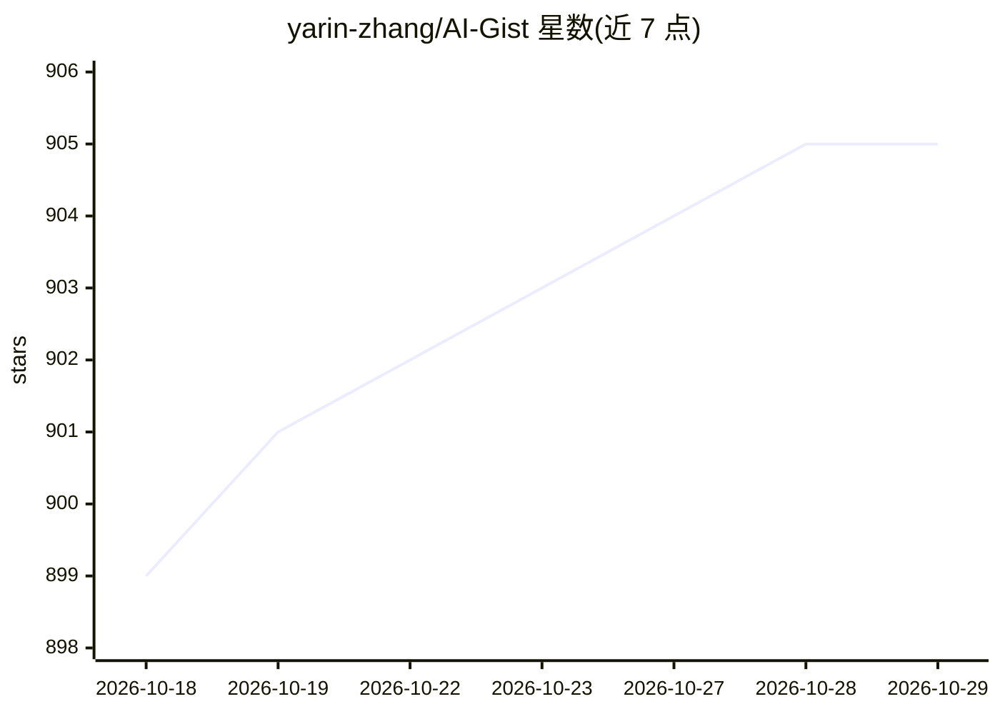

# yarin-zhang/AI-Gist

⭐ 905 · TypeScript · AGPL-3.0 · 推送 2026-10-28 · [GitHub](https://github.com/yarin-zhang/AI-Gist) · [官网](https://getaigist.com) · 个人维护 · 中文 README

**隐私优先的本地 AI 提示词管理工具，支持 AI 生成与调优**

面向个人用户的 AI 提示词管理工具：以模板方式集中创建、组织提示词，支持变量填充与 Jinja 模板，提供卡片/表格/分类多视图及标签、评分、收藏筛选，并记录使用与编辑历史。集成的 AI 功能包括接入本地模型（Ollama、LM Studio）与 OpenAI、DeepSeek 等在线模型，用于生成、润色提示词与自动提取变量。数据全部本地存储，默认无需联网，支持 WebDAV、iCloud 云备份及 CSV 导出导入。基于 Electron 开发，覆盖 Windows/macOS/Linux 桌面端与 Android/iOS 移动端，采用 AGPL 许可证。

## 筛选速览

| 维度 | 判定 | 备注 |
|---|---|---|
| AI 角色 | `ai-enhanced` | 去掉 AI 部分产品仍成立 |
| 许可风险 | `viral` | AGPL-3.0 |
| 部署形态 | `desktop` | 安装包/桌面程序 |
| 模型依赖 | local-ok | 支持本地模型 |
| 硬件要求 | — | 无带数字的原话,不猜 |
| 安装摩擦 | `low` | 无编译、无系统依赖或容器化 |
| 成熟度 | — | 结构信号不足 |

## 能力要点

- 变量填充与 Jinja 模板，使用时动态填入变量值
- 接入 Ollama、LM Studio 本地模型及 OpenAI、DeepSeek 等在线模型，支持 AI 生成/润色提示词与自动提取变量
- 数据 100% 本地存储，支持 WebDAV、iCloud 云备份与 CSV 导出导入
- 覆盖 Windows/macOS/Linux 桌面端与 Android/iOS 移动端

## 适用场景

- 集中管理我收藏的 AI 提示词并按标签分类查找
- 用 AI 帮我生成和润色提示词，自动挖出变量
- 在多台设备间通过云备份同步提示词库

## 场景标签

`提示工程` · 领域:Agent 开发

## 证据(README 行号)

> L9: ✨ AI Gist 是一款隐私优先的 AI 提示词管理工具，致力于让个人收藏的 AI 提示词能够发挥最大价值。
> L19: AI Gist 提供基础的 AI 提示词管理功能，旨在帮助用户高效地创建、组织和使用 AI 提示词。支持 Jinja 模板。
> L31: * **AI 生成**：使用 AI 快捷生成提示词，支持自定义系统提示词。

## 星数曲线

2026-10-18 899 → 2026-10-29 905（+6）

---
*卡片 v1 · prompt 1.4 · 生成 2026-10-21 · 置信度 high · 依据 README sha `84b426ffb7b8` · [字段定义](../../DATASET.md)*
