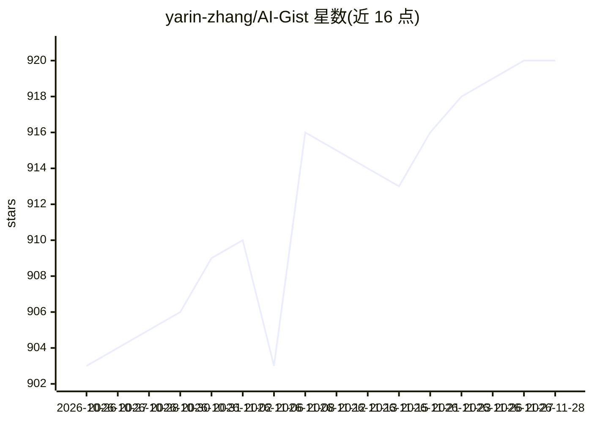

# yarin-zhang/AI-Gist

⭐ 920 · TypeScript · AGPL-3.0 · 推送 2026-10-29 · [GitHub](https://github.com/yarin-zhang/AI-Gist) · [官网](https://getaigist.com) · 个人维护 · 中文 README

**隐私优先的 AI 提示词管理与生成工具**

一款本地优先的 AI 提示词管理工具，提供变量填充、Jinja 模板、多视图管理、分类筛选与历史版本记录；并集成 AI 模型实现提示词的生成、调优与变量自动提取，支持接入本地模型（Ollama、LM Studio）与 OpenAI、DeepSeek 等在线模型。数据全部存储在本地，支持 WebDAV、iCloud 云备份与 CSV 导出，多语言界面，覆盖 Windows/macOS/Linux/Android/iOS 六端，以安装包形式分发，无需编译。

## 筛选速览

| 维度 | 判定 | 备注 |
|---|---|---|
| AI 角色 | `ai-enhanced` | 去掉 AI 部分产品仍成立 |
| 许可风险 | `viral` | AGPL-3.0 |
| 部署形态 | `desktop` | 安装包/桌面程序 |
| 模型依赖 | local-ok | 支持本地模型 |
| 硬件要求 | — | 无带数字的原话,不猜 |
| 安装摩擦 | `low` | 无编译、无系统依赖或容器化 |
| 成熟度 | — | 结构信号不足 |

## 能力要点

- 变量填充与 Jinja 模板，支持卡片/表格/分类多视图管理与历史记录
- AI 生成、润色与自动提取变量，支持自定义系统提示词
- 本地优先，支持 WebDAV、iCloud 备份与 CSV 导出
- 覆盖桌面与移动五平台及四种界面语言

## 适用场景

- 集中管理个人收藏的提示词模板并复用
- 让 AI 自动生成或润色提示词、提取变量
- 多设备间通过 WebDAV/iCloud 同步提示词库

## 场景标签

`提示工程` · 领域:Agent 开发

## 证据(README 行号)

> L9: ✨ AI Gist 是一款隐私优先的 AI 提示词管理工具，致力于让个人收藏的 AI 提示词能够发挥最大价值。
> L28: AI Gist 还集成了 AI 模型，支持自动生成和调整提示词，提升管理效率。用之前，改一改。

## 星数曲线

2026-10-26 903 → 2026-11-28 920（+17）

---
*卡片 v1 · prompt 1.4 · 生成 2026-11-24 · 置信度 high · 依据 README sha `3535c1100a56` · [字段定义](../../DATASET.md)*
