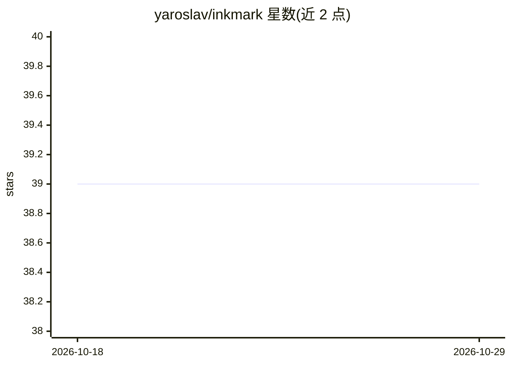

# yaroslav/inkmark

⭐ 39 · Rust · MIT · 推送 2026-10-24 · [GitHub](https://github.com/yaroslav/inkmark) · [官网](https://yaroslav.io/opensource/inkmark) · 个人维护

**面向 Ruby 的 AI 优先 Markdown 解析库：渲染、分块与结构化抽取**

基于 Rust pulldown-cmark 的 Ruby Markdown gem，支持 CommonMark 与 GFM 规范，提供 HTML 渲染、语法高亮、frontmatter、TOC、wikilinks、脚注、安全策略（默认拒绝 raw HTML、主机/URL scheme 白名单）等大量选项。面向构建文档处理与 RAG 管道的开发者：提供标题层级分块（带面包屑与字符/词计数）和滑动窗口分块两种原语、面向上下文窗口预算的截断、供 embedding 模型使用的纯文本抽取，以及对标题/链接/图片/代码块的结构化抽取（含源文本字节范围）。要求 Ruby 3.3+，gem 预编译无需本地编译工具链。

## 筛选速览

| 维度 | 判定 | 备注 |
|---|---|---|
| AI 角色 | `ai-ecosystem` | LLM/agent 周边工具 |
| 许可风险 | `permissive` | MIT |
| 部署形态 | `None` |  |
| 模型依赖 | — | README 未给出锁定关系 |
| 硬件要求 | — | 无带数字的原话,不猜 |
| 安装摩擦 | `low` | 无编译、无系统依赖或容器化 |
| 成熟度 | — | 结构信号不足 |

## 能力要点

- 标题分块与滑动窗口分块两种 chunking 原语
- 块感知/词感知截断用于上下文窗口预算控制
- 标题/链接/图片/代码块结构化抽取，记录源文档字节范围
- 默认拒绝 raw HTML，链接/图片支持主机与 scheme 白名单

## 适用场景

- 为 RAG 管道将 Markdown 文档切成带层级信息的块
- 从 Markdown 中抽取纯文本供 embedding 模型使用
- 在 Rails/Ruby 应用中按 GFM 规范安全渲染用户提交的 Markdown

## 场景标签

`文档解析` · 领域:知识与检索

## 证据(README 行号)

> L15: - **AI-first**. Two chunking primitives: heading-based with breadcrumbs and per-chunk character/word counts, and sl
> L3: A very fast, feature-packed, AI-first Markdown gem for Ruby.

## 星数曲线

2026-10-18 39 → 2026-10-29 39（+0）

---
*卡片 v1 · prompt 1.4 · 生成 2026-10-25 · 置信度 high · 依据 README sha `f5f63df97286` · [字段定义](../../DATASET.md)*
