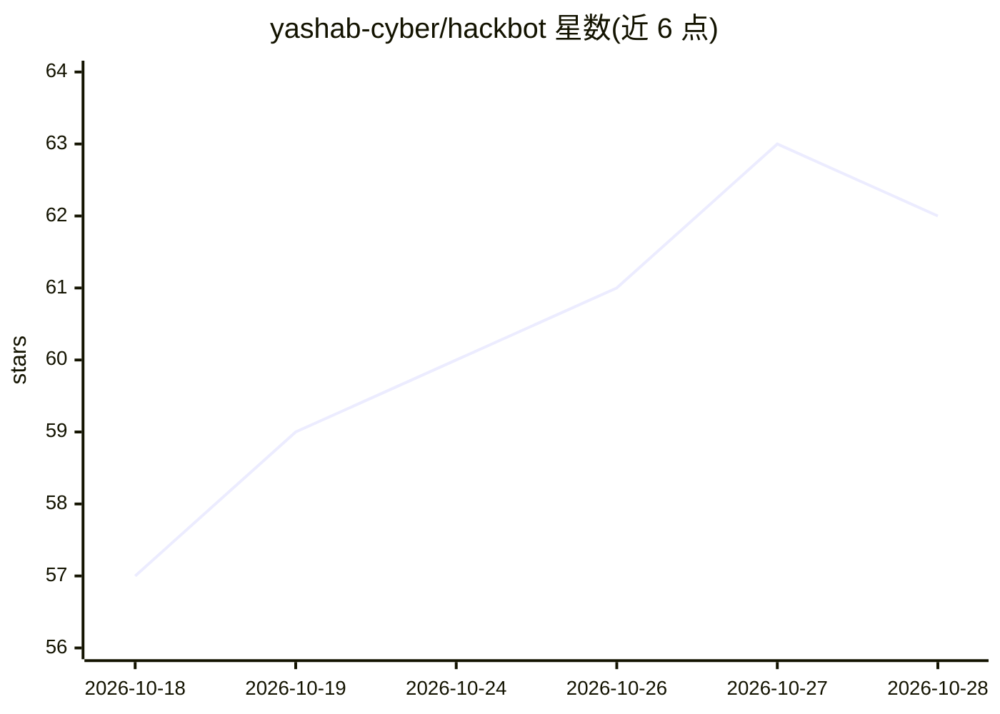

# yashab-cyber/hackbot

⭐ 63 · Python · MIT · 推送 2026-09-22 · [GitHub](https://github.com/yashab-cyber/hackbot) · [官网](https://hackbot.co.in) · 个人维护

**AI 渗透测试助手：Agent/聊天/规划三模式驱动安全测试**

面向安全测试人员的 AI 助手，含 Agent（自主运行 nmap、nuclei 等安全工具并分析结果）、聊天问答与渗透测试规划三种模式，提供 pywebview 桌面 GUI 与终端 UI。内置 CVE 查询、OSINT 侦查、合规映射（PCI DSS/NIST/OWASP）、MITRE ATT&CK 映射、漏洞数据库、流量拦截代理与智能模糊测试（150+ payload）等模块，支持 10 家 AI 提供商切换，可生成 HTML/Markdown/PDF 报告。安装途径覆盖 pip、pipx、一键脚本、源码与 Docker。

## 筛选速览

| 维度 | 判定 | 备注 |
|---|---|---|
| AI 角色 | `ai-native` | 本体是模型或模型工具 |
| 许可风险 | `permissive` | MIT |
| 部署形态 | `self-host` | docker 或自建部署 |
| 模型依赖 | local-ok | 支持本地模型 |
| 硬件要求 | — | 无带数字的原话,不猜 |
| 安装摩擦 | `low` | 无编译、无系统依赖或容器化 |
| 成熟度 | — | 结构信号不足 |

## 能力要点

- Agent 模式自主执行 50+ 安全工具并跟踪严重度分级发现
- 内置 CVE 查询、OSINT、MITRE ATT&CK 与合规框架映射
- pywebview 原生桌面 GUI，含代理拦截、拓扑可视化与插件面板
- 支持 OpenAI、Anthropic、Ollama 等 10 家 AI 提供商切换

## 适用场景

- 安全测试人员让 AI 自主规划并执行渗透测试流程
- 对扫描结果做合规框架与 ATT&CK 映射并出报告
- 多目标协同评估与两次评估间的漏洞差异对比

## 场景标签

`网络安全` · 领域:学习与行业

## 证据(README 行号)

> L5: **Production-ready AI-powered pentesting & cybersecurity assistant with Agent, Chat & Planning modes, native desktop
> L42: |🤖 **Agent Mode**|Autonomous penetration testing — runs real security tools, analyzes results, adapts strategy|
> L59: |🌍 **10 AI Providers**|OpenAI, Anthropic, Google Gemini, Groq, Mistral, DeepSeek, Together AI, OpenRouter, Ollama, 

## 星数曲线

2026-10-18 57 → 2026-10-28 62（+5）

---
*卡片 v1 · prompt 1.4 · 生成 2026-10-24 · 置信度 high · 依据 README sha `221d9f12d5a1` · [字段定义](../../DATASET.md)*
