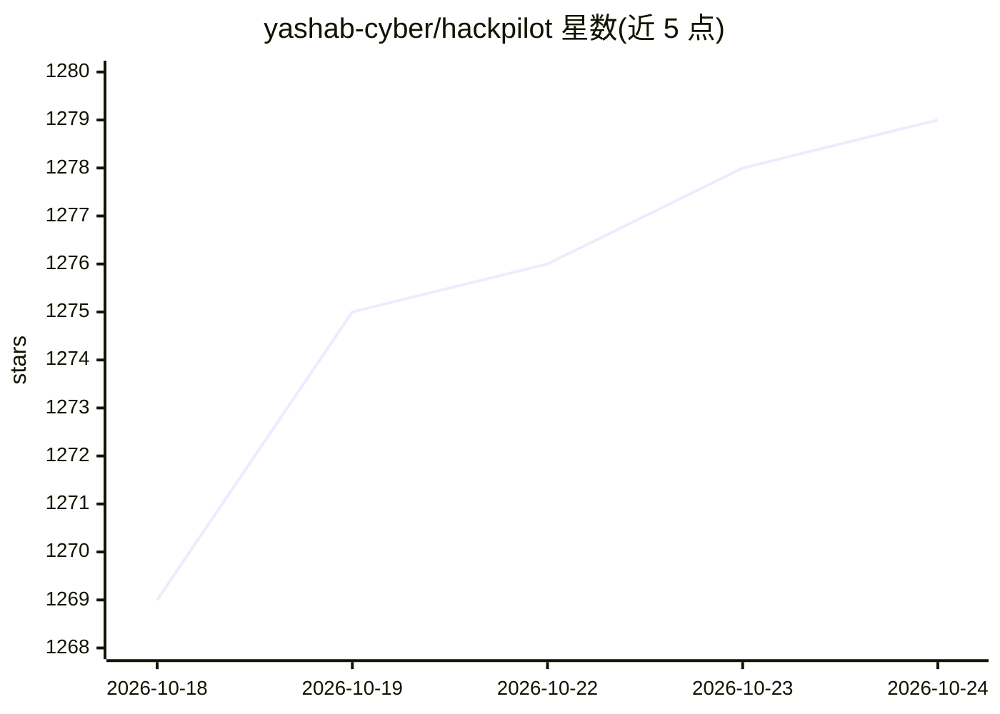

# yashab-cyber/hackpilot

⭐ 1,283 · Python · NOASSERTION · 推送 2026-10-22 · [GitHub](https://github.com/yashab-cyber/hackpilot) · [官网](https://yashab-cyber.github.io/hackpilot/) · 个人维护

**面向企业安全团队的 AI 驱动渗透测试平台**

HackPilot Enterprise 是面向企业安全团队的云原生渗透测试平台，按 6 阶段方法论（侦察、扫描、漏洞评估、利用、报告、复测）组织流程，集成 Nmap、Metasploit、Nuclei 等工具。AI 引擎支持 7 个提供商、26+ 模型并可运行时切换，提供 CVSS 评分、合规映射（OWASP/NIST/ISO27001 等）与自动报告。架构为 Python/Flask 微服务，配合 Docker Compose/Kubernetes 部署，含 SOC/SIEM 关联引擎（Splunk/QRadar/Elasticsearch 连接器）。需自备各外部工具与 AI API key。

## 筛选速览

| 维度 | 判定 | 备注 |
|---|---|---|
| AI 角色 | `ai-native` | 本体是模型或模型工具 |
| 许可风险 | `none` | NOASSERTION |
| 部署形态 | `self-host` | docker 或自建部署 |
| 模型依赖 | local-ok | 支持本地模型 |
| 硬件要求 | — | 无带数字的原话,不猜 |
| 安装摩擦 | `low` | 无编译、无系统依赖或容器化 |
| 成熟度 | — | 结构信号不足 |

## 能力要点

- 7 个 AI 提供商、26+ 模型，支持运行时切换与自动回退
- SOC/SIEM 关联引擎：日志解析、IOC 提取、MITRE ATT&CK 映射
- 6 阶段渗透测试方法论，覆盖 OWASP/NIST/ISO27001/SOC2/PCI-DSS 合规映射
- 微服务栈：Docker/Kubernetes、Celery、PostgreSQL、Redis、Prometheus/Grafana

## 适用场景

- 企业安全团队执行并报告渗透测试项目
- 将渗透测试结果映射到合规框架生成报告
- SOC 场景下做日志关联分析与事件时间线重建

## 场景标签

`网络安全` · 领域:学习与行业

## 证据(README 行号)

> L26: - **7 AI Providers**: OpenAI, Anthropic (Claude), Google (Gemini), DeepSeek, GLM (Zhipu), Local LLMs (Ollama), Open
> L32: - **Automated Reporting**: Executive summaries, technical details, compliance mapping

## 星数曲线

2026-10-18 1,269 → 2026-10-24 1,279（+10）

---
*卡片 v1 · prompt 1.4 · 生成 2026-10-21 · 置信度 low · 依据 README sha `72babd16139f` · [字段定义](../../DATASET.md)*
