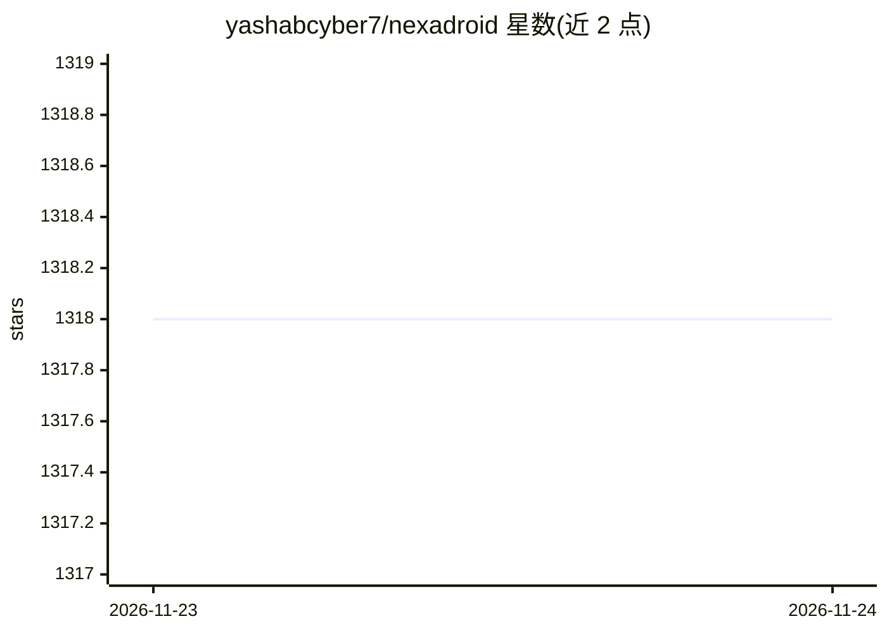

# yashabcyber7/nexadroid

⭐ — · [GitHub]() · 个人维护

**多智能体 AI Android 自动化系统：自然语言分解任务并执行**

面向 Android 的多智能体平台：Master Agent 将自然语言目标分解为 DAG 任务树，分派给手机控制、社交媒体、内容创作、研究、邮件、文件管理等专项 Agent，通过 Accessibility Services 与 Intents 执行无需 root 的 UI 自动化，配合 StateVerifier 验证执行结果。安全模型按风险分级审批高危操作，含提示注入防御与紧急停止开关；上下文由 5 层记忆体系管理。需自行用 Gradle 编译 APK，未提供安装包。

## 筛选速览

| 维度 | 判定 | 备注 |
|---|---|---|
| AI 角色 | `ai-native` | 本体是模型或模型工具 |
| 许可风险 | `permissive` | — |
| 部署形态 | `None` |  |
| 模型依赖 | — | README 未给出锁定关系 |
| 硬件要求 | — | 无带数字的原话,不猜 |
| 安装摩擦 | `medium` | 含编译或系统依赖之一 |
| 成熟度 | — | 结构信号不足 |

## 能力要点

- Master Agent 将自然语言目标分解为 DAG 任务树并行调度
- 基于 Accessibility Services 的零 root Android UI 自动化与状态验证
- 三级风险审批 + 提示注入防御 + 紧急停止开关
- 5 层记忆架构与会话/任务/长期记忆持久化

## 适用场景

- 用自然语言指挥手机完成多步应用操作
- 自动化管理多个社交平台的发帖与回复
- 让 Agent 代为整理文件、撰写邮件草稿与日程

## 场景标签

`多智能体` `GUI 自动化` · 领域:Agent 开发

## 证据(README 行号)

> L6:  Production-Ready Multi-Agent AI Operating System for Android
> L13: NexaDroid transforms Android into an autonomous, intelligent multi-agent environment where a central **Master Agent

## 星数曲线

2026-11-23 1,318 → 2026-11-24 1,318（+0）

---
*卡片 v1 · prompt 1.4 · 生成 2026-11-23 · 置信度 high · 依据 README sha `cced55ee9199` · [字段定义](../../DATASET.md)*
