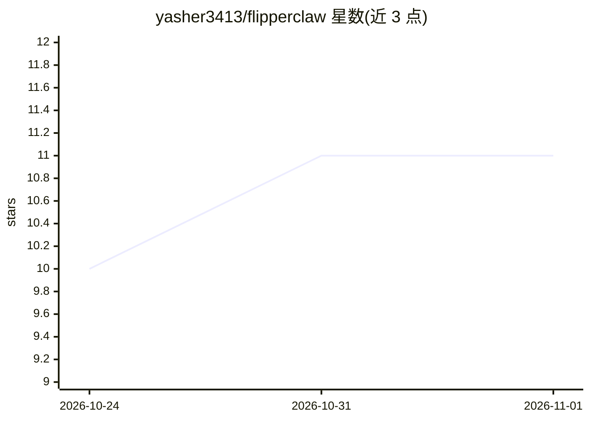

# yasher3413/flipperclaw

⭐ 11 · C++ · MIT · 推送 2026-04-18 · [GitHub](https://github.com/yasher3413/flipperclaw) · [官网](https://www.flipperclaw.com) · 个人维护

**跑在 ESP32-S3、以 Flipper Zero 为屏幕的离线硬件 LLM agent**

开源 AI agent 项目：ESP32-S3 通过 HTTPS 调用云端 LLM API（Anthropic 或 OpenAI，可运行时切换），Flipper Zero 充当物理 UI，经 UART+Base64 协议通信。实现 ReAct 工具调用循环（每轮最多 5 次），提供 web 搜索、NFC 读取、Sub-GHz 重放、IR 发送、cron 调度等工具；SOUL.md/USER.md/MEMORY.md 等文件存于 SPIFFS 构成持久记忆。需自备 Flipper Zero 与 ESP32-S3 开发板，用 ESP-IDF 与 uFBT 编译烧录，经串口 CLI 配置 WiFi 与 API key。相对灵感来源 MimiClaw 增加了 NFC/Sub-GHz/IR 硬件工具。

## 筛选速览

| 维度 | 判定 | 备注 |
|---|---|---|
| AI 角色 | `ai-native` | 本体是模型或模型工具 |
| 许可风险 | `permissive` | MIT |
| 部署形态 | `None` |  |
| 模型依赖 | locked-api |  |
| 硬件要求 | — | 无带数字的原话,不猜 |
| 安装摩擦 | `low` | 无编译、无系统依赖或容器化 |
| 成熟度 | — | 结构信号不足 |

## 能力要点

- 流式 LLM 输出直接显示在 Flipper Zero 屏幕
- ReAct agent 循环，工具含 NFC 读卡、Sub-GHz 重放、IR 发送
- SOUL.md/MEMORY.md/HEARTBEAT.md 持久记忆与 30 分钟任务队列
- Anthropic 与 OpenAI 双 provider 运行时切换

## 适用场景

- 在口袋硬件上运行可调用 Flipper 硬件的 LLM agent
- 让 agent 定时执行 cron 任务与待办清单
- 用 LLM 现场读取并分析 NFC 标签内容

## 场景标签

`AI 助手` `Agent 记忆` · 领域:Agent 开发

## 证据(README 行号)

> L3: **An open-source AI agent running on ESP32-S3 with a Flipper Zero as the physical UI.**
> L39: - **Streaming LLM responses** — tokens appear on the Flipper screen as they arrive, no waiting

## 星数曲线

2026-10-24 10 → 2026-11-01 11（+1）

---
*卡片 v1 · prompt 1.4 · 生成 2026-11-01 · 置信度 high · 依据 README sha `67c817d8802b` · [字段定义](../../DATASET.md)*
