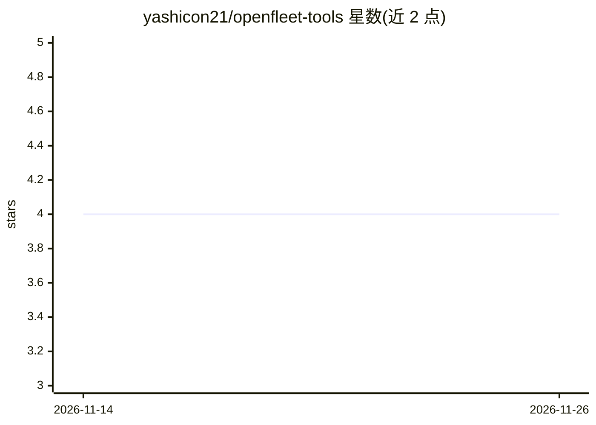

# yashicon21/openfleet-tools

⭐ 4 · TypeScript · MIT · 推送 2026-11-15 · [GitHub](https://github.com/yashicon21/openfleet-tools) · [官网](https://openfleet.tools) · 个人维护

**让多 agent 并行跨仓库/多包执行同一大型代码变更**

OpenFleet 以 CLI 工具形式协调一个大型变更在多个仓库、monorepo 包或路径范围单元上并行执行：coordinator agent 与用户形成规格后，对每个单元运行 planner→implementer→tester 流水线，各单元在独立 git worktree 中工作，产出 draft PR；多子单元仓库由 repo coordinator 合并为一个集成分支与 PR。所有 agent 动作记录到 append-only 事件日志，支持 state.json 恢复运行。依赖宿主 agent（Copilot CLI 或 Claude Code），非独立 agent 运行时；仅支持 macOS/Linux 及 WSL2。

## 筛选速览

| 维度 | 判定 | 备注 |
|---|---|---|
| AI 角色 | `ai-ecosystem` | LLM/agent 周边工具 |
| 许可风险 | `permissive` | MIT |
| 部署形态 | `library` | 以包/库形式分发 |
| 模型依赖 | — | README 未给出锁定关系 |
| 硬件要求 | — | 无带数字的原话,不猜 |
| 安装摩擦 | `low` | 无编译、无系统依赖或容器化 |
| 成熟度 | — | 结构信号不足 |

## 能力要点

- 一次描述变更，多仓库/多包并行 planner→implementer→tester 流水线
- 每个子任务独立 git worktree 与分支，最终合并为一个 PR
- events.jsonl 记录归属、补丁与 diff 快照，支持 openfleet resume 恢复
- Greenfield 模式：从系统描述生成仓库并构建 MVP 切片

## 适用场景

- 把一个大迁移（如换认证服务）拆到多个仓库并行执行
- 在单个 monorepo 中按包/页面/模块并行改造后合并为一个 PR
- 从零描述一个新系统并生成初始仓库与 MVP

## 场景标签

`多智能体` `编码 Agent` · 领域:Agent 开发

## 证据(README 行号)

> L7: Coordinate **one big change across many repos, or many parts of one repo**, or build **a new system from scratch**, 
> L19: OpenFleet is built from the host's own primitives (custom agents, subagents, hooks, skills). It is not a new agent 

## 星数曲线

2026-11-14 4 → 2026-11-26 4（+0）

---
*卡片 v1 · prompt 1.4 · 生成 2026-11-21 · 置信度 high · 依据 README sha `fe29e4b0ed33` · [字段定义](../../DATASET.md)*
