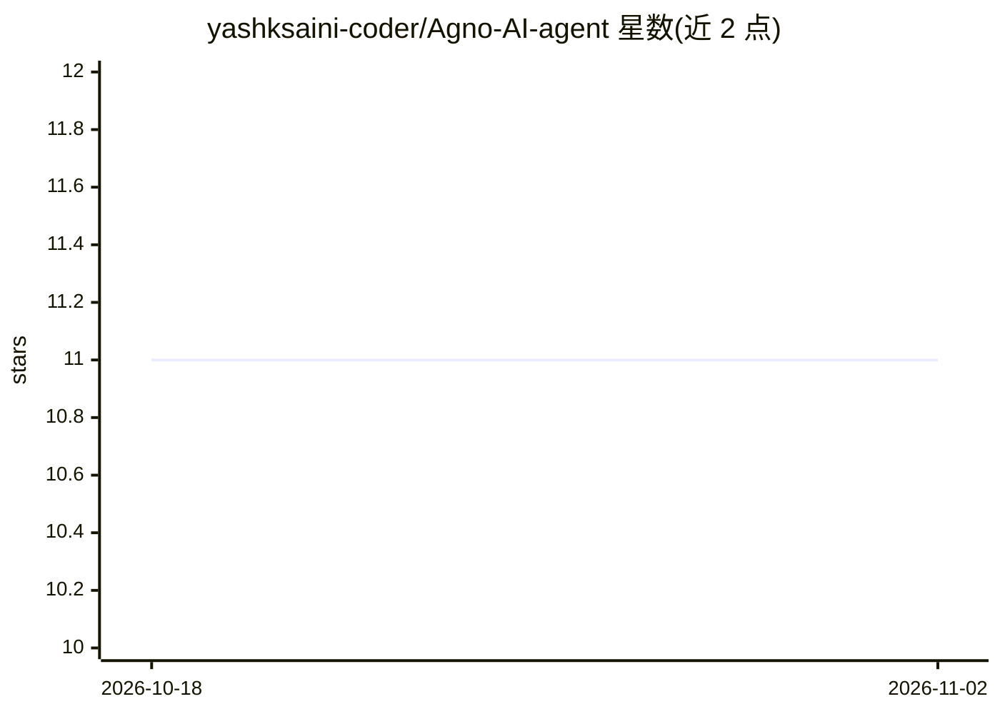

# yashksaini-coder/Agno-AI-agent

⭐ 11 · Python · 推送 2026-01-04 · [GitHub](https://github.com/yashksaini-coder/Agno-AI-agent) · 个人维护

**基于 Agno 框架与 Groq 模型的多智能体应用**

一个使用 Agno（原 Phidata）框架、结合 Groq 模型构建的多智能体项目，据仓库描述覆盖网页搜索与金融数据分析两类智能体，定位为通过智能决策自动化工作流。README 仅提供基本说明：要求 Python 3.8+，通过 git clone 源码方式安装运行，未展示完整代码或配置细节。由印度的个人开发者维护。

## 筛选速览

| 维度 | 判定 | 备注 |
|---|---|---|
| AI 角色 | `ai-native` | 本体是模型或模型工具 |
| 许可风险 | `none` | — |
| 部署形态 | `None` |  |
| 模型依赖 | — | README 未给出锁定关系 |
| 硬件要求 | — | 无带数字的原话,不猜 |
| 安装摩擦 | `low` | 无编译、无系统依赖或容器化 |
| 成熟度 | — | 结构信号不足 |

## 能力要点

- 基于 Agno 框架构建多智能体
- 结合 Groq 模型进行推理
- 按仓库描述覆盖网页搜索与金融数据分析

## 适用场景

- 需要联网搜索并汇总信息的自动化任务
- 金融数据的智能分析辅助

## 场景标签

`多智能体` `数据分析` · 领域:Agent 开发

## 证据(README 行号)

> L5: *An intelligent AI agent for automated workflows and decision-making*
> L9: Agno AI Agent is a powerful automation tool that leverages artificial intelligence to streamline complex workflows a

## 星数曲线

2026-10-18 11 → 2026-11-02 11（+0）

---
*卡片 v1 · prompt 1.4 · 生成 2026-11-01 · 置信度 mid · 依据 README sha `6cc416e71d8a` · [字段定义](../../DATASET.md)*
