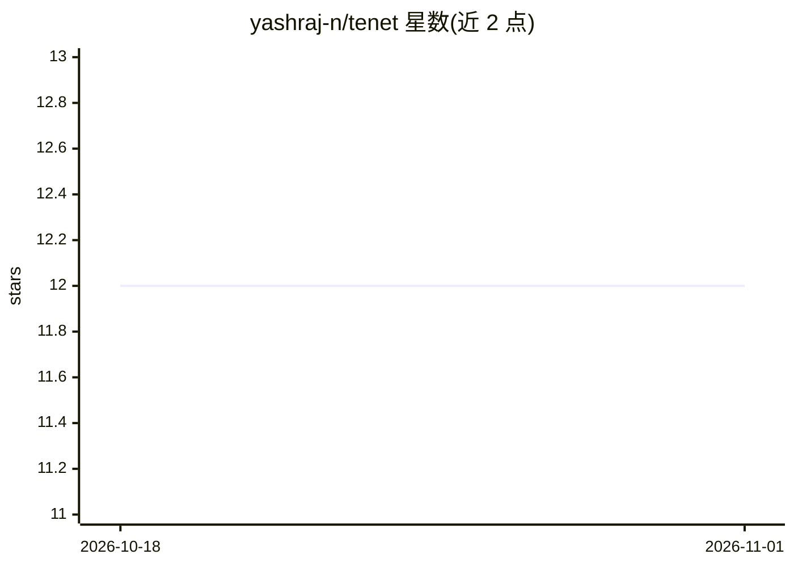

# yashraj-n/tenet

⭐ 12 · TypeScript · ISC · 推送 2026-08-22 · [GitHub](https://github.com/yashraj-n/tenet) · [官网](https://tenet.yashrajn.com) · 个人维护

**自动解决 GitHub issue 并审查 PR 的 AI agent**

通过 GitHub 触发的自主编码 agent：在 issue 下评论 /tenet-build，agent 克隆仓库，用 read/grep/list/write 工具探索代码，在新分支提交修复并开 PR；另可对 PR 输出结构化审查（摘要、逐文件说明、Mermaid 时序图与安全/质量/性能/可维护性发现）。用户自带 LLM key（OpenAI/Anthropic/Google/Azure/Cohere/Mistral/OpenRouter），AES-256 加密存储，每用户 2 天 2 次运行。Bun monorepo，agent 在 Docker 沙箱内经 Google Cloud Run 执行，需自建 MongoDB 与 GitHub App。

## 筛选速览

| 维度 | 判定 | 备注 |
|---|---|---|
| AI 角色 | `ai-native` | 本体是模型或模型工具 |
| 许可风险 | `permissive` | ISC |
| 部署形态 | `None` |  |
| 模型依赖 | — | README 未给出锁定关系 |
| 硬件要求 | — | 无带数字的原话,不猜 |
| 安装摩擦 | `low` | 无编译、无系统依赖或容器化 |
| 成熟度 | — | 结构信号不足 |

## 能力要点

- issue_build 模式：读取 issue、探索仓库、提交修复并开 PR
- pr_review 模式：结构化审查含严重级别分级与建议修复
- 支持 7 家 LLM 供应商，密钥 AES-256 加密存储
- agent 在 Docker 沙箱中经 Google Cloud Run 执行

## 适用场景

- 在 issue 下评论 /tenet-build 让 agent 自动修 bug 并提交 PR
- 对 PR 生成带安全与质量发现的审查报告
- 通过仪表盘跟踪各次 agent 运行进度

## 场景标签

`编码 Agent` `代码审查` · 领域:编码与开发

## 证据(README 行号)

> L5: **An AI agent that resolves GitHub issues and reviews pull requests.**
> L24: |`issue_build`|Comment `/tenet-build` on an issue|Reads the issue, explores the repo with read/grep/list/write tool

## 星数曲线

2026-10-18 12 → 2026-11-01 12（+0）

---
*卡片 v1 · prompt 1.4 · 生成 2026-10-31 · 置信度 high · 依据 README sha `605a7ed4f598` · [字段定义](../../DATASET.md)*
