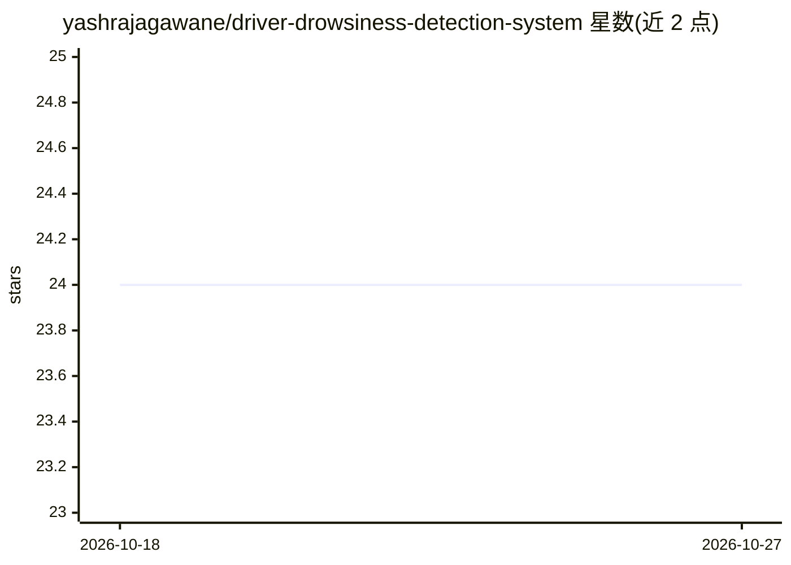

# yashrajagawane/driver-drowsiness-detection-system

⭐ 24 · HTML · 推送 2026-09-23 · [GitHub](https://github.com/yashrajagawane/driver-drowsiness-detection-system) · [官网](https://driver-drowsiness-detection-system-42lp.onrender.com) · 个人维护

**浏览器端实时检测驾驶员疲劳并通过短信/电话告警**

面向驾驶员疲劳监测的 Web 应用：通过浏览器摄像头（WebRTC）采集视频，客户端 MediaPipe FaceLandmarker 478 点人脸网格计算 EAR、MAR 与头部姿态，状态机判定瞌睡、多次哈欠、分心三类告警，触发音频警报并可经 Flask 后端与 Twilio 升级为短信和语音电话。前端全部本地推理，摄像头帧不上传；提供 PWA 离线安装与 Render 一键部署配置，无 Twilio 凭证时检测与告警功能仍可运行。

## 筛选速览

| 维度 | 判定 | 备注 |
|---|---|---|
| AI 角色 | `ai-native` | 本体是模型或模型工具 |
| 许可风险 | `none` | — |
| 部署形态 | `library` | 以包/库形式分发 |
| 模型依赖 | — | README 未给出锁定关系 |
| 硬件要求 | — | 无带数字的原话,不猜 |
| 安装摩擦 | `low` | 无编译、无系统依赖或容器化 |
| 成熟度 | — | 结构信号不足 |

## 能力要点

- 客户端 MediaPipe 478 点人脸网格，EAR/MAR/头姿三信号疲劳检测
- 告警升级管道：音频警报 + Twilio 短信/语音电话（含前后端冷却防刷）
- 可安装 PWA，缓存模型与音频支持离线运行
- 附 render.yaml 支持 Render 一键部署

## 适用场景

- 个人长途驾驶时用笔记本摄像头监测自身疲劳状态
- 车队管理中监测司机疲劳情况
- 作为 ADAS 集成原型或计算机视觉教学示例

## 场景标签

`人脸识别` · 领域:感知与多模态

## 证据(README 行号)

> L20: > ⚡ **Multi-signal fatigue detection using MediaPipe Face Landmarks, Eye Aspect Ratio (EAR), Mouth Aspect Ratio (MA
> L51: |🧠 **100% Client-Side AI**|All face detection and fatigue analysis runs in the browser via MediaPipe — zero server-
> L155: 1. 📷 **Capture** — Browser streams live video via WebRTC (`getUserMedia`)

## 星数曲线

2026-10-18 24 → 2026-10-27 24（+0）

---
*卡片 v1 · prompt 1.4 · 生成 2026-10-27 · 置信度 high · 依据 README sha `b89d3fd59f1c` · [字段定义](../../DATASET.md)*
