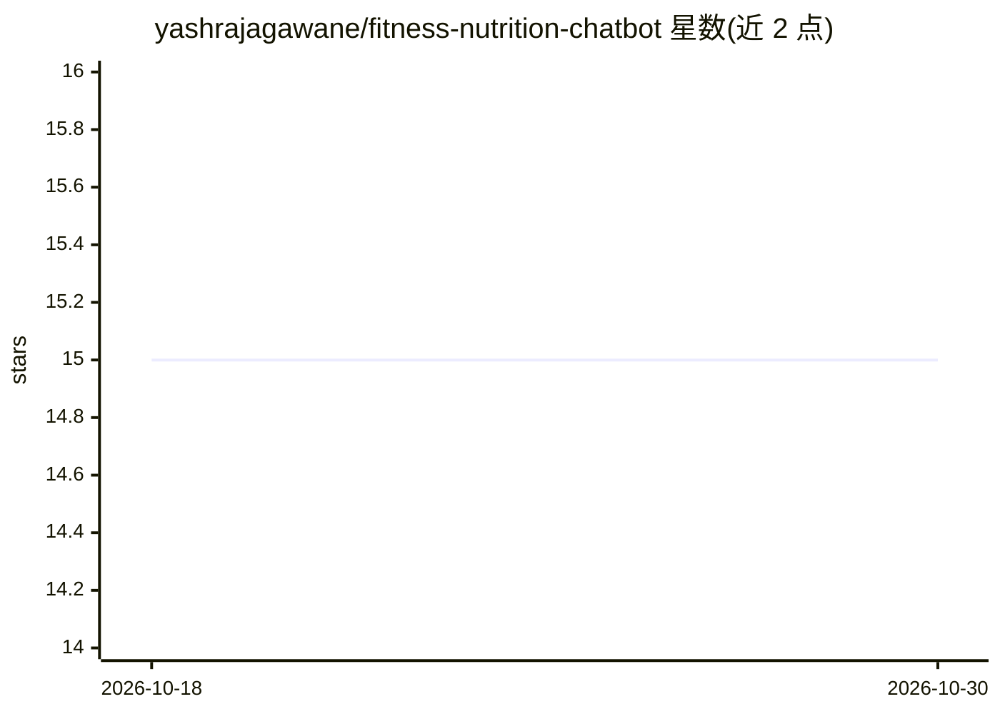

# yashrajagawane/fitness-nutrition-chatbot

⭐ 15 · TypeScript · 推送 2026-08-29 · [GitHub](https://github.com/yashrajagawane/fitness-nutrition-chatbot) · [官网](https://fitness-nutrition-chatbot.vercel.app) · 个人维护

**浏览器与手机主屏可装的 AI 健身营养教练应用**

基于 Next.js + React 的全栈 Web 应用，调用 Google Gemini 生成个性化训练、营养、恢复与宏量营养素建议，回答带摘要、行动计划与安全提示，并附健康免责声明。支持多咨询会话、可选个人资料（年龄/体重/目标等）注入 AI 上下文、计划保存与进展记录（训练/体重/饮水/睡眠）。可安装为 PWA，应用外壳离线可用但 AI 与数据请求需联网；认证用可选的 Supabase 邮箱登录，默认数据存于浏览器本地。本地运行需配置 Gemini API key。

## 筛选速览

| 维度 | 判定 | 备注 |
|---|---|---|
| AI 角色 | `ai-native` | 本体是模型或模型工具 |
| 许可风险 | `none` | — |
| 部署形态 | `library` | 以包/库形式分发 |
| 模型依赖 | — | README 未给出锁定关系 |
| 硬件要求 | — | 无带数字的原话,不猜 |
| 安装摩擦 | `low` | 无编译、无系统依赖或容器化 |
| 成熟度 | — | 结构信号不足 |

## 能力要点

- Gemini 驱动的个性化训练/营养/恢复/宏量营养素建议
- PWA 可安装到手机主屏，应用外壳与静态资源离线缓存
- 多咨询会话、计划保存、进展记录与 JSON 备份导入导出
- 可选 Supabase 邮箱认证，默认数据保存在浏览器本地

## 适用场景

- 在手机上以 PWA 形式获取健身与饮食建议
- 管理多个咨询会话并保存有用的训练计划
- 记录训练、体重、饮水、睡眠等进展数据

## 场景标签

 · 领域:健康健身/对话应用

## 证据(README 行号)

> L36: - Personalized workout, nutrition, recovery, and macro guidance.
> L90: |Google Gemini|AI coaching responses|

## 星数曲线

2026-10-18 15 → 2026-10-30 15（+0）

---
*卡片 v1 · prompt 1.4 · 生成 2026-10-30 · 置信度 high · 依据 README sha `61e14111b496` · [字段定义](../../DATASET.md)*
