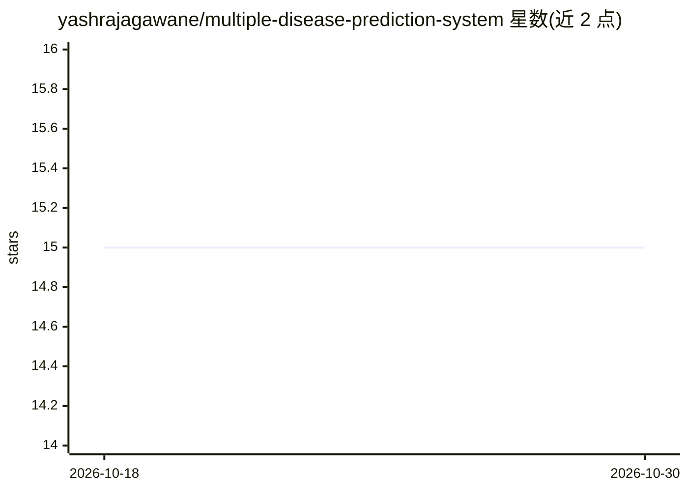

# yashrajagawane/multiple-disease-prediction-system

⭐ 15 · Python · 推送 2026-07-28 · [GitHub](https://github.com/yashrajagawane/multiple-disease-prediction-system) · [官网](https://medical-risk-analyzer-yash.streamlit.app) · 个人维护

**预测 5 种疾病风险的 Streamlit 医疗 Web 应用**

基于 Python、Scikit-learn 与 Streamlit 构建的医疗 Web 应用，在单一界面中集成糖尿病（SVM）、心脏病（随机森林）、肝病（梯度提升）、肾病（随机森林）与乳腺癌（随机森林）5 个疾病风险预测模型，用户输入特征后实时返回预测结果。模型以 Pickle 持久化，部署于 Streamlit Cloud。安装方式为克隆仓库、创建虚拟环境、pip 安装依赖后 streamlit run 运行；作者为 B.Tech 学生个人项目，部分模型准确率数据未附验证来源。

## 筛选速览

| 维度 | 判定 | 备注 |
|---|---|---|
| AI 角色 | `ai-native` | 本体是模型或模型工具 |
| 许可风险 | `none` | — |
| 部署形态 | `library` | 以包/库形式分发 |
| 模型依赖 | — | README 未给出锁定关系 |
| 硬件要求 | — | 无带数字的原话,不猜 |
| 安装摩擦 | `low` | 无编译、无系统依赖或容器化 |
| 成熟度 | — | 结构信号不足 |

## 能力要点

- 5 种疾病模型集成于单一 Streamlit 仪表盘
- 模型涵盖 SVM、随机森林、梯度提升
- Pickle 模型持久化与预处理流水线
- 已部署至 Streamlit Cloud

## 适用场景

- 输入体检指标快速筛查多种疾病风险
- 医疗数据分析的学习与演示项目
- 作为临床决策支持的原型参考

## 场景标签

 · 领域:医疗/健康预测

## 证据(README 行号)

> L10: > 🏥 **An AI-powered healthcare web app that predicts the risk of 5 diseases using trained ML models.**
> L18: - Model: Support Vector Machine

## 星数曲线

2026-10-18 15 → 2026-10-30 15（+0）

---
*卡片 v1 · prompt 1.4 · 生成 2026-10-30 · 置信度 mid · 依据 README sha `8167ac6e346f` · [字段定义](../../DATASET.md)*
