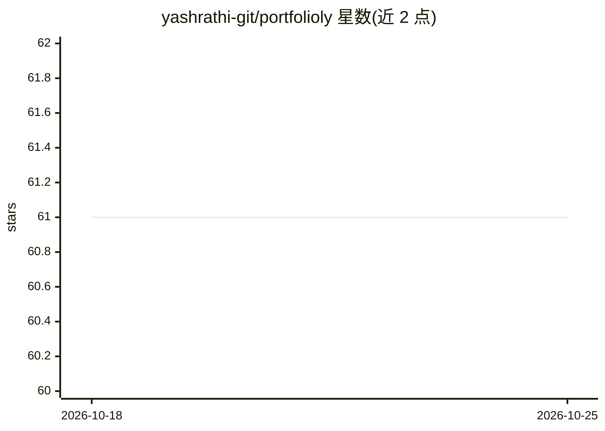

# yashrathi-git/portfolioly

⭐ 61 · TypeScript · AGPL-3.0 · 推送 2025-12-17 · [GitHub](https://github.com/yashrathi-git/portfolioly) · [官网](https://portfolioly.app/) · 个人维护

**把简历/GitHub/LinkedIn 变成作品集网站的 AI 生成工具**

面向求职者与开发者的作品集生成平台：上传 PDF 简历、连接 GitHub 或导入 LinkedIn 后，由 AI 抽取经历、项目与技能并生成可分享的作品集网站；提供一键部署到 Vercel。生成的作品集可切换为聊天模式，由类 ChatGPT 助手回答关于本人经历的问题。技术栈为 Next.js/FastAPI/Firebase，AI 数据抽取使用 Azure AI，代码以 Yarn workspaces monorepo 组织，可自托管或克隆独立模板部署。

## 筛选速览

| 维度 | 判定 | 备注 |
|---|---|---|
| AI 角色 | `ai-native` | 本体是模型或模型工具 |
| 许可风险 | `viral` | AGPL-3.0 |
| 部署形态 | `None` |  |
| 模型依赖 | — | README 未给出锁定关系 |
| 硬件要求 | — | 无带数字的原话,不猜 |
| 安装摩擦 | `low` | 无编译、无系统依赖或容器化 |
| 成熟度 | — | 结构信号不足 |

## 能力要点

- 从简历 PDF/GitHub/LinkedIn 提取数据生成作品集
- AI 聊天模式：作品集作为助手回答经历相关问题
- 一键部署到 Vercel，或克隆独立模板自行部署
- Yarn workspaces monorepo，含发布到 npm 的模板组件包

## 适用场景

- 求职者快速把简历变成可分享的作品集网站
- 开发者基于 GitHub 资料生成项目展示页
- 访客通过聊天询问站主的项目与技能

## 场景标签

`聊天机器人` · 领域:对话与助手

## 证据(README 行号)

> L36: Portfolioly transforms your existing professional content into a polished, interactive portfolio. Upload a PDF resu
> L41: - **AI Chat Mode** — turns your portfolio into a ChatGPT-like assistant that answers questions about your experienc

## 星数曲线

2026-10-18 61 → 2026-10-25 61（+0）

---
*卡片 v1 · prompt 1.4 · 生成 2026-10-24 · 置信度 high · 依据 README sha `c87343733c20` · [字段定义](../../DATASET.md)*
