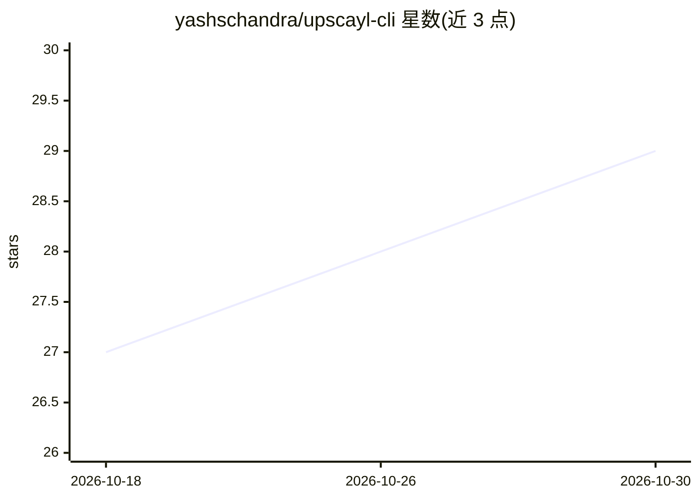

# yashschandra/upscayl-cli

⭐ 29 · Go · MIT · 推送 2026-05-23 · [GitHub](https://github.com/yashschandra/upscayl-cli) · 个人维护

**在终端或服务器上无 GUI 运行 Upscayl 图像放大的 CLI 工具**

用 Go 编写的命令行工具，将 Upscayl 的图像放大能力以 CLI 与可选 HTTP 服务器形式提供：可通过本地路径或 URL 读取图像并放大输出，支持下载指定 Upscayl 模型（默认 upscayl-standard-4x）并保留原版大部分设置项。安装方式目前仅有本地构建（需 go 1.17）或从 releases 下载（仅 Mac intel/silicon 与 Linux，当前 v0.0.6），打包分发与模型列表命令仍在开发中。

## 筛选速览

| 维度 | 判定 | 备注 |
|---|---|---|
| AI 角色 | `ai-native` | 本体是模型或模型工具 |
| 许可风险 | `permissive` | MIT |
| 部署形态 | `None` |  |
| 模型依赖 | — | README 未给出锁定关系 |
| 硬件要求 | — | 无带数字的原话,不猜 |
| 安装摩擦 | `low` | 无编译、无系统依赖或容器化 |
| 成熟度 | — | 结构信号不足 |

## 能力要点

- CLI 与可选 HTTP 服务器两种运行方式，提供 /upscayl API
- 支持从本地路径或 URL 读取输入图像
- 可下载指定 Upscayl 模型，默认 upscayl-standard-4x
- 保留原版大部分设置，可通过 --help 查看

## 适用场景

- 在没有 GUI 的服务器上批量放大图像
- 通过 HTTP API 将图像放大集成到其他工具或流程
- 在终端中用不同 Upscayl 模型处理图像

## 场景标签

`图像视频处理` · 领域:感知与多模态

## 证据(README 行号)

> L3: A command line tool to run Upscayl without GUI
> L8: - 🌐 Optionally run a server to integrate with other tools
> L38: By default `upscayl-standard-4x` model is used.

## 星数曲线

2026-10-18 27 → 2026-10-30 29（+2）

---
*卡片 v1 · prompt 1.4 · 生成 2026-10-26 · 置信度 high · 依据 README sha `a0b425b42f77` · [字段定义](../../DATASET.md)*
