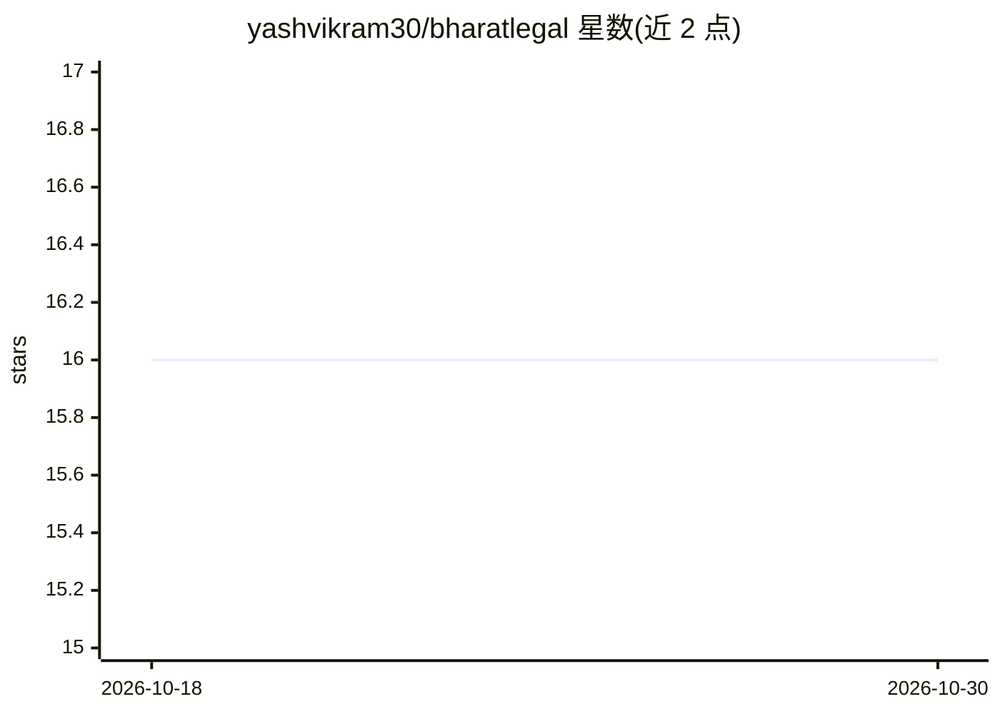

# yashvikram30/bharatlegal

⭐ 16 · TypeScript · 推送 2026-10-04 · [GitHub](https://github.com/yashvikram30/bharatlegal) · [官网](https://bharatlegal.vercel.app) · 个人维护

**面向印度公民的 AI 法律咨询平台：问答、文书分析与案件追踪**

开源公民科技 Web 平台，基于 Next.js 15 + TypeScript 构建，为印度公民提供六项功能：基于 Groq Cloud（gpt-oss-120b/20b）的法律问答聊天机器人、案件追踪仪表板、五类公民权利的通俗化图解、法律文书上传与风险条款分析（PDF/DOCX/TXT ≤10MB，原文档不留存）、NALSA/SLSA/DLSA 免费法律援助目录与热线，以及联系方式提交。认证用 NextAuth.js，数据存 MongoDB。平台声明输出不构成正式法律意见。

## 筛选速览

| 维度 | 判定 | 备注 |
|---|---|---|
| AI 角色 | `ai-native` | 本体是模型或模型工具 |
| 许可风险 | `none` | — |
| 部署形态 | `library` | 以包/库形式分发 |
| 模型依赖 | locked-api |  |
| 硬件要求 | — | 无带数字的原话,不猜 |
| 安装摩擦 | `low` | 无编译、无系统依赖或容器化 |
| 成熟度 | — | 结构信号不足 |

## 能力要点

- 基于印度法律体系（BNS/BNSS/消费者保护法）的引用式法律问答
- 文书简化器：摘要、识别高风险赔偿/仲裁条款、标记合规期限
- 案件追踪：CNR 号、开庭日期、律师备注（地区法院至最高法院）
- NALSA/SLSA/DLSA 免费法律援助目录与验证热线

## 适用场景

- 我想不用请律师就弄懂自己的法律权利
- 上传租约或雇佣合同，找出高风险条款
- 追踪自己在各级法院的案子进度
- 找到附近免费法律援助和热线电话

## 场景标签

`聊天机器人` `文档问答` · 领域:对话与助手

## 证据(README 行号)

> L10: - Powered by high-throughput LLaMA / GPT-OSS inference on **Groq Cloud**.
> L27: ### 4. 📄 Document Simplifier (`/simplify`)
> L48: - **AI Inference**: Groq Cloud SDK (`openai/gpt-oss-120b`, `openai/gpt-oss-20b`)

## 星数曲线

2026-10-18 16 → 2026-10-30 16（+0）

---
*卡片 v1 · prompt 1.4 · 生成 2026-10-30 · 置信度 high · 依据 README sha `63effbf19487` · [字段定义](../../DATASET.md)*
