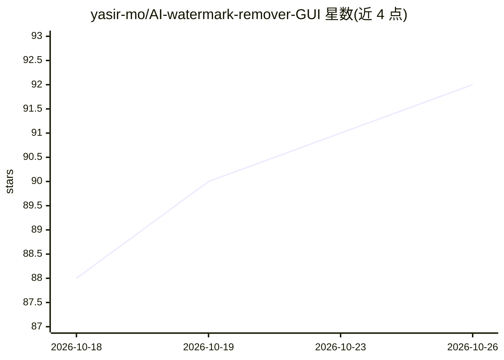

# yasir-mo/AI-watermark-remover-GUI

⭐ 92 · Python · MIT · 推送 2026-08-21 · [GitHub](https://github.com/yasir-mo/AI-watermark-remover-GUI) · [官网](https://yasir-mo.github.io/AI-watermark-remover-GUI/) · 个人维护

**检测并清除 AI 文本水印与文档元数据的研究工具**

本地运行的 AI 水印检查与清除工具，面向希望出版自署名作品的研究者与用户。分三层：Layer A 确定性删除不可见 Unicode 字符；Metadata 层清除 PNG/JPEG/WebP/SVG/PDF/Office 等 10 余种格式的 C2PA/EXIF/XMP/属性元数据；Layer B 通过第二模型改写文本以置换 KGW、SynthID-Text 等统计水印。核心仅用 Python 3.10+ 标准库，PDF 深度清除需可选的 exiftool/qpdf。提供 CLI、HTTP 服务、Web UI 与浏览器静态版本；README 明确声明不构成检测规避保证。

## 筛选速览

| 维度 | 判定 | 备注 |
|---|---|---|
| AI 角色 | `ai-enhanced` | 去掉 AI 部分产品仍成立 |
| 许可风险 | `permissive` | MIT |
| 部署形态 | `self-host` | docker 或自建部署 |
| 模型依赖 | local-ok | 支持本地模型 |
| 硬件要求 | — | 无带数字的原话,不猜 |
| 安装摩擦 | `low` | 无编译、无系统依赖或容器化 |
| 成熟度 | — | 结构信号不足 |

## 能力要点

- Layer A 无损确定性清除零宽字符、双向控制符、变体选择符等不可见字符
- 覆盖 PNG/JPEG/WebP/SVG/PDF/DOCX/ODT/HTML/Markdown 等格式的 C2PA/EXIF/XMP 元数据清除
- Layer B 用另一模型改写（paraphrase/humanize/code/backtranslate/structural 五种强度），支持 ollama 与 OpenAI 兼容端点后端
- 浏览器版 Layer A 与 Python 版通过 CI 一致性向量钉合，分歧即阻断部署

## 适用场景

- 发布自己撰写编辑的文档前，清除附带的 AI 元数据与隐藏字符
- 检测文本中是否存在统计水印或隐藏标记
- 批量清洗文件的 AI 来源痕迹并对比前后差异

## 场景标签

 · 领域:AI 内容溯源/文本处理

## 证据(README 行号)

> L5: Finds and removes the marks that AI tools attach to text and files: invisible
> L15: The core is **Python 3.10+ standard library only**. No Flask, no FastAPI, no
> L186: So Layer B rewrites the text with a second model. That model samples from its

## 星数曲线

2026-10-18 88 → 2026-10-26 92（+4）

---
*卡片 v1 · prompt 1.4 · 生成 2026-10-24 · 置信度 mid · 依据 README sha `527ec21f96a2` · [字段定义](../../DATASET.md)*
