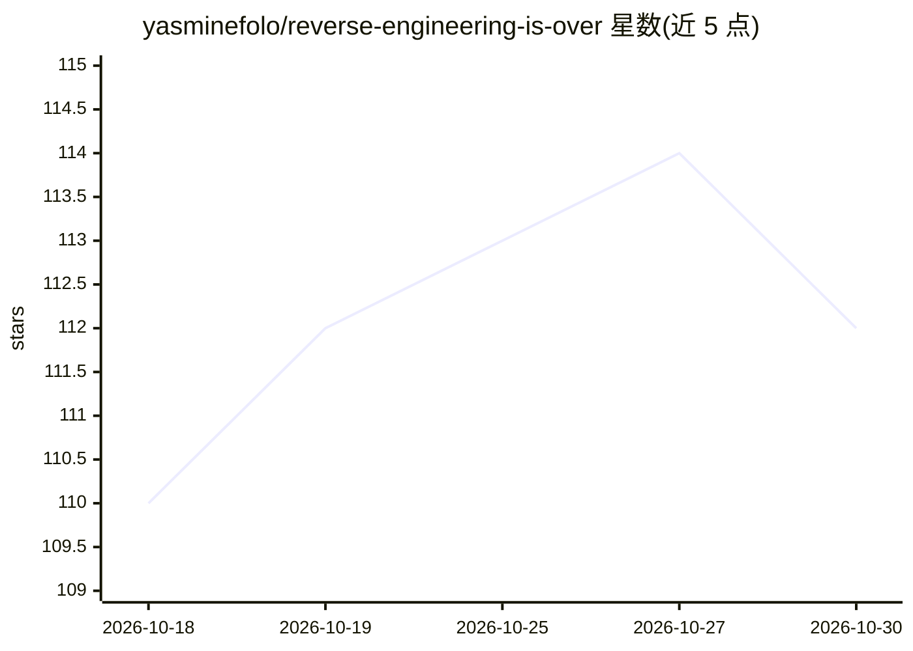

# yasminefolo/reverse-engineering-is-over

⭐ 112 · Python · 推送 2026-05-25 · [GitHub](https://github.com/yasminefolo/reverse-engineering-is-over) · 个人维护 · 中文 README

**AI 辅助逆向工程案例研究论文：还原抖音签名算法**

一篇安全研究论文/写作，而非可安装的软件。作者记录了在约 30 天、约 100 美元成本内，借助 Claude Opus 对一款短视频平台 Android 客户端 v38.1.0 的原生签名库进行分析，还原 7 个自定义 HTTP 签名参数中的 6 个。方法为 Frida 动态插桩收集差分数据、LLM 生成脚本与归纳模式、假设驱动的迭代循环。论文讨论了上下文丢失与幻觉导致的方法论局限，并提出移动安全攻防成本结构变化的结构性结论。

## 筛选速览

| 维度 | 判定 | 备注 |
|---|---|---|
| AI 角色 | `ai-knowledge` | 知识聚合/清单类 |
| 许可风险 | `none` | — |
| 部署形态 | `None` |  |
| 模型依赖 | — | README 未给出锁定关系 |
| 硬件要求 | — | 无带数字的原话,不猜 |
| 安装摩擦 | `low` | 无编译、无系统依赖或容器化 |
| 成熟度 | — | 结构信号不足 |

## 能力要点

- 30 天内还原 7 个自定义签名参数中的 6 个，总成本约 100 美元
- 方法：Frida 动态插桩 + 差分测试向量 + 假设驱动迭代循环
- 记录了后期上下文丢失与幻觉问题，提出检查点纪律的方法论建议
- 提出成功率 ≈ f(模型能力 × 方法论 × token 预算) 的成本结构模型

## 适用场景

- 了解 LLM 辅助逆向分析的实际工作流程与局限
- 作为移动应用安全攻防成本结构变化的案例参考
- 研究 LLM 长上下文对话中的行为机制

## 场景标签

`网络安全` `科研工具` · 领域:学习与行业

## 证据(README 行号)

> L7: ## Abstract
> L9: This paper advances a far-reaching proposition: **The emergence of Large Language Models (LLMs) has fundamentally en
> L86: ### 3.4 Results

## 星数曲线

2026-10-18 110 → 2026-10-30 112（+2）

---
*卡片 v1 · prompt 1.4 · 生成 2026-10-23 · 置信度 high · 依据 README sha `a1e40c1aa0e9` · [字段定义](../../DATASET.md)*
