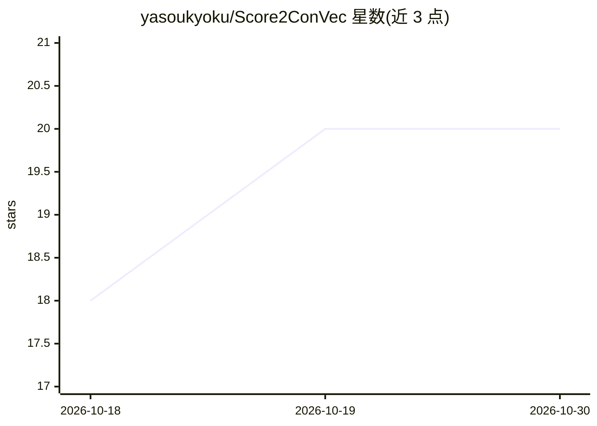

# yasoukyoku/Score2ConVec

⭐ 20 · Python · NOASSERTION · 推送 2026-09-19 · [GitHub](https://github.com/yasoukyoku/Score2ConVec) · 个人维护 · 中文 README

**让 SVC 语音模型按乐谱（MIDI+歌词）唱歌的确定性前端**

面向 so-vits-svc 4.0/4.1 与 RVC v2 等基于 ContentVec 的歌声转换（SVC）模型的 SVS 前端：读取乐谱（音符+歌词），经 G2P 映射为 IPA 音素后生成 speaker-invariant 的 ContentVec 内容特征（[T,D]@50fps），交由 SVC 后端解码为歌声；f0 由 DAW 单独提供。将音高/内容/音色三轴解耦，音色模型仅需约 10-15 分钟干声且无需音素标注。内容模型确定性输出（无采样），支持 7 种语言，代码 MIT、权重仅限研究/非商业用途。

## 筛选速览

| 维度 | 判定 | 备注 |
|---|---|---|
| AI 角色 | `ai-native` | 本体是模型或模型工具 |
| 许可风险 | `none` | NOASSERTION |
| 部署形态 | `library` | 以包/库形式分发 |
| 模型依赖 | — | README 未给出锁定关系 |
| 硬件要求 | — | 无带数字的原话,不猜 |
| 安装摩擦 | `medium` | 含编译或系统依赖之一 |
| 成熟度 | — | 结构信号不足 |

## 能力要点

- 乐谱→ContentVec 特征的确定性生成，同一乐谱同一输出
- 后端无关：支持 so-vits-svc 4.0/4.1 与 RVC v2（768-d/256-d 两种权重）
- 音色模型仅需约 10-15 分钟干声，无需人工音素标注
- 支持 zh/ja/en/de/fr/es/it 七种语言（IPA 词表 210 tokens）

## 适用场景

- 把已有的 so-vits-svc/RVC 翻唱模型变成能按乐谱演唱的歌声合成歌手
- 在 DAW 中以参数化 f0 控制音高制作歌声
- 用 UST（UTAU/SynthV 导出）文件验证歌词到音素的映射

## 场景标签

`语音合成` · 领域:内容生成

## 证据(README 行号)

> L10: Score2ConVec (Score-to-ContentVec) is a small, deterministic **SVS front-end** for **SVC** voice models.
> L16:   score  ──G2P + arrays──▶  Score2ConVec  ──▶  ContentVec [T, D] @50fps ──┐
> L41: |**so-vits-svc 4.1**|vec768l12 (768-d)|`ScoreToCV` 768|`cv_final.pt`|

## 星数曲线

2026-10-18 18 → 2026-10-30 20（+2）

---
*卡片 v1 · prompt 1.4 · 生成 2026-10-28 · 置信度 high · 依据 README sha `9968d947ec8e` · [字段定义](../../DATASET.md)*
