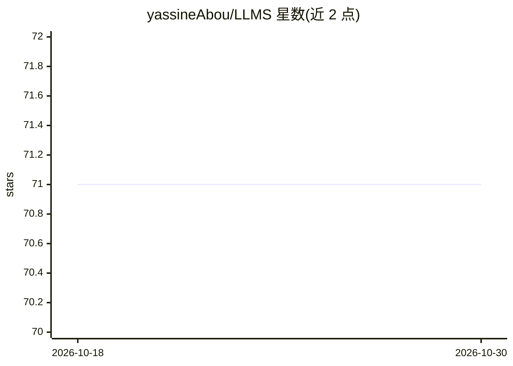

# yassineAbou/LLMS

⭐ 71 · Kotlin · Apache-2.0 · 推送 2026-08-21 · [GitHub](https://github.com/yassineAbou/LLMS) · 个人维护

**跨平台 AI 文本与图像生成应用，供用户选用开源模型**

Kotlin Multiplatform + Compose 构建的多端应用，覆盖 Android、iOS、Desktop 与 WebAssembly。通过 Pollinations.ai 的统一 API 调用开源文本与图像模型，用户选择模型后生成文本或图像，并借助 Google Authentication（Firebase）实现数据跨设备同步。运行方式为在 Android Studio/IntelliJ 中打开项目选择运行配置，或用 Xcode 运行 iOS 端；Google 登录需自行配置密钥文件后方可启用，代码中含测试用假数据。

## 筛选速览

| 维度 | 判定 | 备注 |
|---|---|---|
| AI 角色 | `ai-native` | 本体是模型或模型工具 |
| 许可风险 | `permissive` | Apache-2.0 |
| 部署形态 | `None` |  |
| 模型依赖 | — | README 未给出锁定关系 |
| 硬件要求 | — | 无带数字的原话,不猜 |
| 安装摩擦 | `low` | 无编译、无系统依赖或容器化 |
| 成熟度 | — | 结构信号不足 |

## 能力要点

- 基于 Pollinations.ai 统一 API 生成文本与图像
- Android/iOS/Desktop/WebAssembly 四端 Kotlin Multiplatform 实现
- Firebase Google 登录实现跨设备数据同步
- 后端使用 Ktor 框架，UI 使用 Compose Multiplatform

## 适用场景

- 在手机或桌面端生成文本与图像内容
- 跨设备同步保存生成的作品
- 作为 Kotlin Multiplatform 项目结构参考

## 场景标签

`聊天机器人` `图像生成` · 领域:对话与助手

## 证据(README 行号)

> L22: This app uses Pollinations.ai — an open-source AI platform providing a unified API for text and image generation.
> L14: Discover the power of AI with our Kotlin Multiplatform app. Choose from the latest open-source text and image model

## 星数曲线

2026-10-18 71 → 2026-10-30 71（+0）

---
*卡片 v1 · prompt 1.4 · 生成 2026-10-24 · 置信度 high · 依据 README sha `6f6845149cf6` · [字段定义](../../DATASET.md)*
