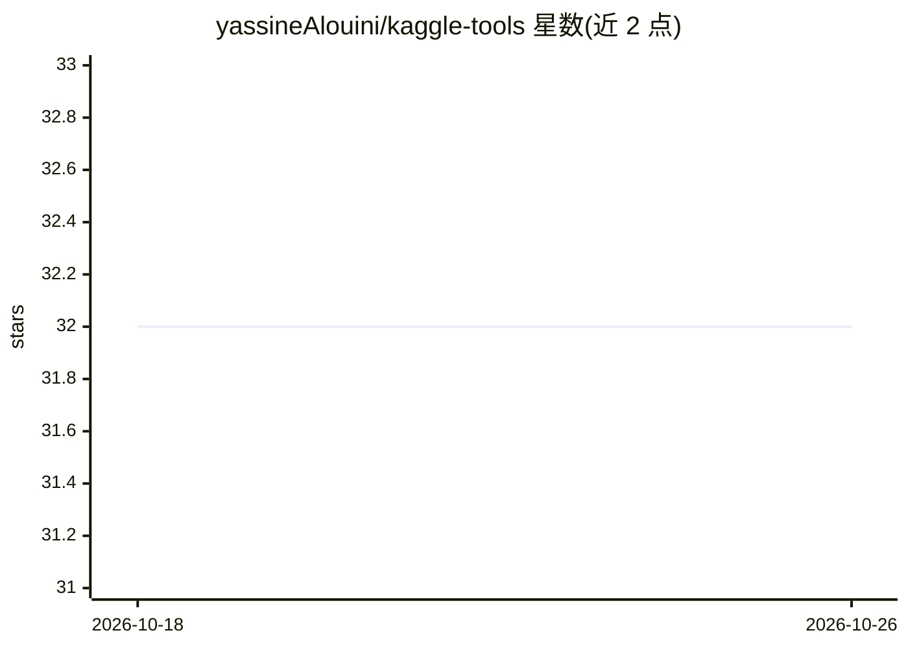

# yassineAlouini/kaggle-tools

⭐ 32 · Python · MIT · 推送 2026-10-25 · [GitHub](https://github.com/yassineAlouini/kaggle-tools) · 个人维护

**Kaggle 竞赛 Python 工具库与 Claude Code 技能插件**

面向 Kaggle 竞赛参与者的 Python 工具集：提供环境路径解析（/kaggle/input 各挂载布局）、渐进式提交文件保护、集成方法（rank_blend、hill_climb）、空间/稀有类 CV 折、时间预算、kernel 推送 lint 与提交台账等模块，核心依赖仅 numpy/pandas/scikit-learn，Trackio/Optuna/LightGBM 等为可选 extras。另以 Claude Code 插件形式发布 7 个竞赛技能（playbook、代码赛、生物声学、LLM 推理/微调、表格等）。通过 pip/uv 从 GitHub 安装或 Claude Code 插件市场安装。

## 筛选速览

| 维度 | 判定 | 备注 |
|---|---|---|
| AI 角色 | `ai-ecosystem` | LLM/agent 周边工具 |
| 许可风险 | `permissive` | MIT |
| 部署形态 | `library` | 以包/库形式分发 |
| 模型依赖 | locked-api |  |
| 硬件要求 | — | 无带数字的原话,不猜 |
| 安装摩擦 | `low` | 无编译、无系统依赖或容器化 |
| 成熟度 | — | 结构信号不足 |

## 能力要点

- ProgressiveSubmission 保证每阶段后磁盘上留有有效提交文件
- kt check 在 kaggle kernels push 前做 lint（网络开启、未固定 T4、裸 assert 等报错/警告）
- 7 个 Claude Code 技能覆盖 CV 设计、离线重跑、LLM 推理/微调、表格等竞赛场景
- Ledger 按 kernel 版本记录提交及 LB 增量

## 适用场景

- 写 Kaggle 推理 notebook 时避免提交文件损坏或路径错误
- 赛前 lint kernel 元数据与 notebook 源码再推送
- 为 Claude Code 挂载竞赛经验技能辅助打比赛

## 场景标签

 · 领域:机器学习竞赛工具

## 证据(README 行号)

> L3: Small, battle-tested Python utilities **and Claude Code skills** for Kaggle competitions.
> L66: ## Claude Code skills
> L29: |`env`|`competition_dir` / `dataset_dir` resolve every `/kaggle/input` mount layout; `is_competition_rerun`; `insta

## 星数曲线

2026-10-18 32 → 2026-10-26 32（+0）

---
*卡片 v1 · prompt 1.4 · 生成 2026-10-25 · 置信度 high · 依据 README sha `29e41a4e57d2` · [字段定义](../../DATASET.md)*
