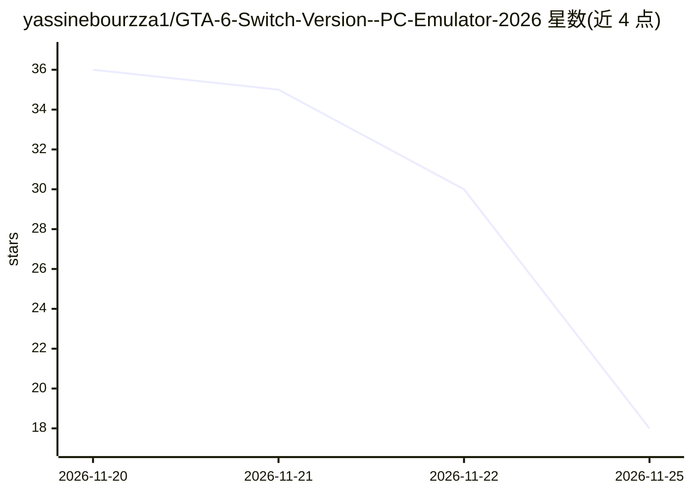

# yassinebourzza1/GTA-6-Switch-Version--PC-Emulator-2026

⭐ — · [GitHub]() · 个人维护

**面向 Windows 玩家的 GTA VI PC 版安装准备与配置指南**

一个围绕尚未发布 PC 版的 Grand Theft Auto VI 的 Windows 安装与配置资源：提供系统兼容性检查、显卡驱动更新指引（NVIDIA/AMD/Intel）、存储检查、Rockstar Games Launcher 准备、画质与 FPS 优化建议及常见故障排查。README 明确说明其配套安装器不包含 GTA VI 游戏文件，游戏需经授权渠道另行获取；官方 PC 版发布日期与系统要求均未公布。以 Windows 安装包（.exe）与文档形式提供。

## 筛选速览

| 维度 | 判定 | 备注 |
|---|---|---|
| AI 角色 | `ai-enhanced` | 去掉 AI 部分产品仍成立 |
| 许可风险 | `permissive` | — |
| 部署形态 | `desktop` | 安装包/桌面程序 |
| 模型依赖 | — | README 未给出锁定关系 |
| 硬件要求 | — | 无带数字的原话,不猜 |
| 安装摩擦 | `low` | 无编译、无系统依赖或容器化 |
| 成熟度 | — | 结构信号不足 |

## 能力要点

- Windows 兼容性准备：系统版本、DirectX、驱动与存储检查
- 画质与 FPS 优化条目说明及常见性能问题排查
- GPU 驱动官方更新渠道指引（NVIDIA/AMD/Intel）
- 明确声明安装器不含 GTA VI 游戏文件

## 适用场景

- 在 GTA VI PC 版发布前提前准备 Windows 环境与驱动
- 排查 PC 游戏常见低帧、卡顿与显示问题
- 了解并准备 Rockstar Games Launcher

## 场景标签

 · 领域:游戏/桌面工具

## 证据(README 行号)

> L17: This repository is dedicated to Windows users preparing for the future PC edition of GTA VI.
> L49: The companion installer does not contain or install GTA VI game files.

## 星数曲线

2026-11-20 36 → 2026-11-25 18（-18）

---
*卡片 v1 · prompt 1.4 · 生成 2026-11-20 · 置信度 low · 依据 README sha `6954d37a13d3` · [字段定义](../../DATASET.md)*
