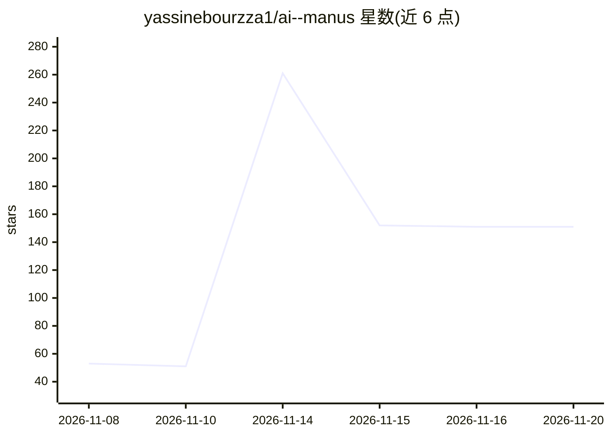

# yassinebourzza1/ai--manus

⭐ 151 · Apache-2.0 · 推送 2026-11-19 · [GitHub](https://github.com/yassinebourzza1/ai--manus) · 个人维护

**面向个人用户的自主 AI Agent，代跑代码与控制浏览器**

README 宣称的自主 AI 代理：代表用户编写并执行脚本、控制浏览器（打开网页、填表、抓取信息）、执行多步骤日常任务（整理研究资料、安排提醒等），定位为家庭、学习与轻量办公的个人助手，面向非开发者。支持跨会话记忆工作流模式。文档为宣传式描述，未给出安装命令、代码结构、模型接入方式或仓库实际内容说明；兼容性表列出最低双核 CPU、4 GB 内存等运行条件。

## 筛选速览

| 维度 | 判定 | 备注 |
|---|---|---|
| AI 角色 | `ai-native` | 本体是模型或模型工具 |
| 许可风险 | `permissive` | Apache-2.0 |
| 部署形态 | `None` |  |
| 模型依赖 | — | README 未给出锁定关系 |
| 硬件要求 | — | 无带数字的原话,不猜 |
| 安装摩擦 | `low` | 无编译、无系统依赖或容器化 |
| 成熟度 | — | 结构信号不足 |

## 能力要点

- 自主编写并执行代码完成任务
- 浏览器控制：导航网页、填表、采集信息
- 代码与浏览器动作可在同一任务流中衔接
- 跨会话记住并复用已建立的工作流模式

## 适用场景

- 让代理代为收集网页资料并整理成摘要
- 自动执行重复性脚本与小型任务
- 学习与远程办公场景下委托琐碎事务

## 场景标签

`AI 助手` `工作流自动化` `浏览器自动化` · 领域:效率与自动化

## 证据(README 行号)

> L10: - **Autonomous Code Execution:** Manus AI agent runs code on its own to complete tasks, so you can focus on decisio
> L18: Manus is an autonomous AI agent designed to run code and control a browser on your behalf. Instead of acting like a

## 星数曲线

2026-11-08 53 → 2026-11-20 151（+98）

---
*卡片 v1 · prompt 1.4 · 生成 2026-11-18 · 置信度 mid · 依据 README sha `844d14a1a1ab` · [字段定义](../../DATASET.md)*
