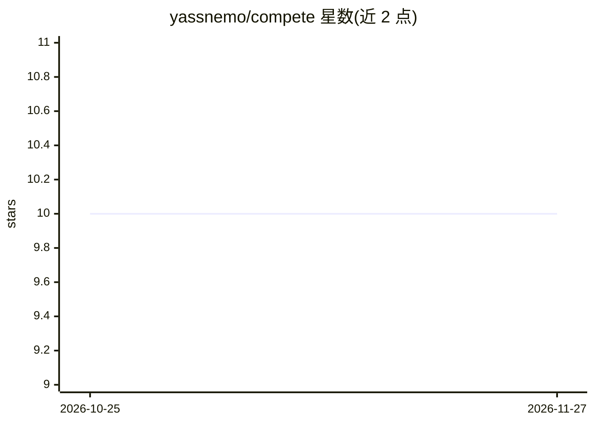

# yassnemo/compete

⭐ 10 · TypeScript · MIT · 推送 2026-07-03 · [GitHub](https://github.com/yassnemo/compete) · [官网](https://compete.yerradouani.me) · 个人维护

**定时 agent 监控竞品网站/博客/定价/新闻/招聘并生成报告的平台**

对可配置的竞品清单（网站、博客、定价页、新闻、招聘帖）运行定时采集 agent，用 LLM 抽取结构化信号，存入 DuckDB 文件数仓，经 dbt 构建分层模型并做快照差异变更检测，输出 Next.js 仪表盘与每周 markdown→PDF 报告。采集支持静态/动态/RSS/招聘页，爬取遵守 robots.txt 并限速。公共 demo 无服务器部署，数据烤成静态 JSON 由 Vercel 托管，由 GitHub Action 每周刷新，默认/本地 provider 下零成本。

## 筛选速览

| 维度 | 判定 | 备注 |
|---|---|---|
| AI 角色 | `ai-native` | 本体是模型或模型工具 |
| 许可风险 | `permissive` | MIT |
| 部署形态 | `library` | 以包/库形式分发 |
| 模型依赖 | local-ok | 支持本地模型 |
| 硬件要求 | — | 无带数字的原话,不猜 |
| 安装摩擦 | `low` | 无编译、无系统依赖或容器化 |
| 成熟度 | — | 结构信号不足 |

## 能力要点

- provider 无关的 LLM 抽取（Gemini Flash 默认，可切 Groq/Ollama/mock）
- DuckDB + Parquet 文件数仓，dbt staging→marts 及测试
- 快照差异变更检测与自动周报（markdown→PDF）
- YAML 配置添加竞品，无需改代码

## 适用场景

- 定时追踪竞品定价、招聘与产品动态
- 为零成本静态部署维护公开竞品情报页
- 离线 mock 模式演示完整 ETL 管道

## 场景标签

`网页抓取` `工作流自动化` · 领域:效率与自动化

## 证据(README 行号)

> L5: postings), extracts **structured signals** with an LLM, warehouses everything in
> L43: |LLM extraction|provider-agnostic (Gemini Flash default · Groq · Ollama · mock), `instructor` structured outputs|

## 星数曲线

2026-10-25 10 → 2026-11-27 10（+0）

---
*卡片 v1 · prompt 1.4 · 生成 2026-11-19 · 置信度 high · 依据 README sha `d589b1d8580f` · [字段定义](../../DATASET.md)*
