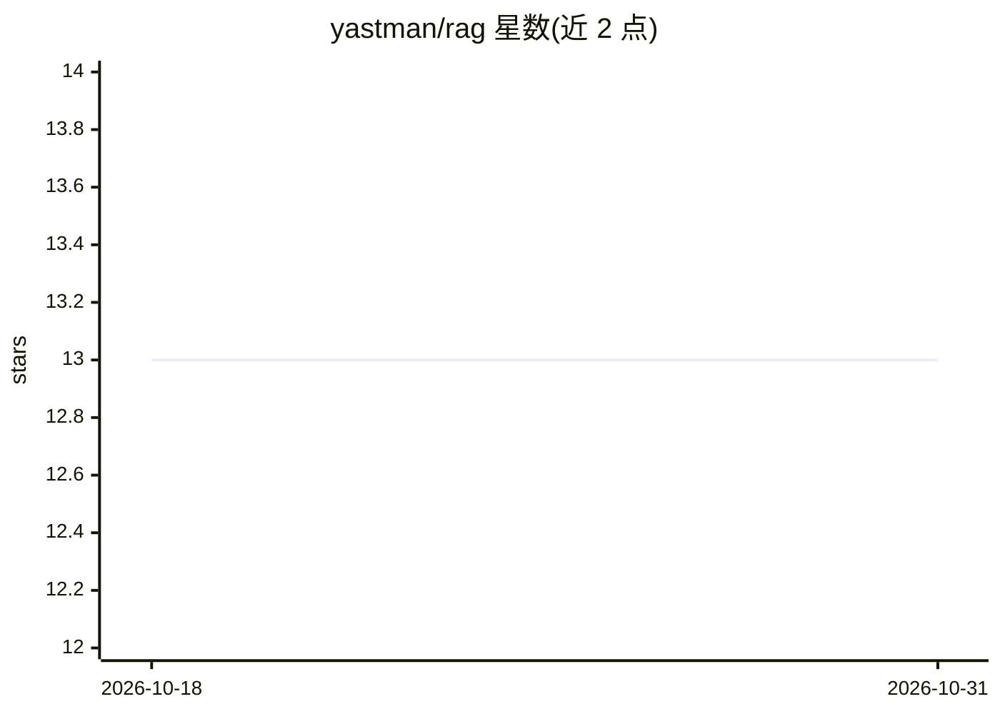

# yastman/rag

⭐ 13 · Python · MIT · 推送 2026-10-30 · [GitHub](https://github.com/yastman/rag) · [官网](https://github.com/yastman/rag/blob/dev/docs/portfolio/resume-case-study.md) · 个人维护

**自托管 Telegram 问答助手：私有文档 RAG 与房产搜索**

以 Python 3.12+ 编写的自托管 Telegram 助手，对私有文档做检索增强问答，并附带房地产层：公寓搜索、服务卡片、看房请求与转交人工。技术栈为进程内核心运行时加 Docker Compose 边车（Qdrant 存搜索数据、BGE-M3 提供嵌入与重排、Redis 提供缓存协调，PostgreSQL 为可选能力）。摄取仅支持 Markdown 且幂等；删除源文件不会自动删除 Qdrant 中的分块。安装经 uv + make/Docker Compose 完成。

## 筛选速览

| 维度 | 判定 | 备注 |
|---|---|---|
| AI 角色 | `ai-native` | 本体是模型或模型工具 |
| 许可风险 | `permissive` | MIT |
| 部署形态 | `self-host` | docker 或自建部署 |
| 模型依赖 | — | README 未给出锁定关系 |
| 硬件要求 | — | 无带数字的原话,不猜 |
| 安装摩擦 | `low` | 无编译、无系统依赖或容器化 |
| 成熟度 | — | 结构信号不足 |

## 能力要点

- 私有文档上的 RAG 问答与确定性产品动作双通道
- Qdrant + BGE-M3（嵌入/重排）+ Redis 边车架构
- 房产搜索、看房请求与经理转交流程
- Markdown-only 幂等摄取，附测试与交付门禁

## 适用场景

- 在 Telegram 内对私有文档提问并获得有据回答
- 房地产团队做公寓搜索与看房请求管理
- 以 Docker Compose 自托管整套问答与数据服务

## 场景标签

`文档问答` · 领域:知识与检索

## 证据(README 行号)

> L3: A self-hosted Telegram assistant for grounded answers over private documents, with a
> L39: Qdrant stores search data; BGE-M3 supplies embeddings/reranking; Redis supplies caches and

## 星数曲线

2026-10-18 13 → 2026-10-31 13（+0）

---
*卡片 v1 · prompt 1.4 · 生成 2026-10-31 · 置信度 high · 依据 README sha `cced04fb124d` · [字段定义](../../DATASET.md)*
