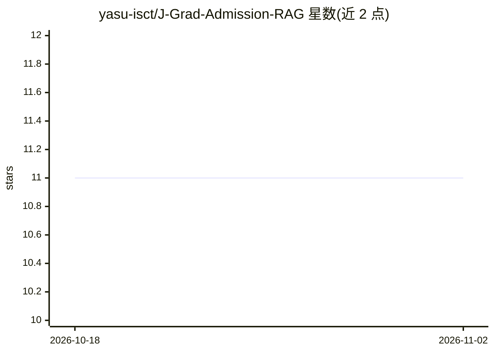

# yasu-isct/J-Grad-Admission-RAG

⭐ 11 · Python · MIT · 推送 2026-10-30 · [GitHub](https://github.com/yasu-isct/J-Grad-Admission-RAG) · [官网](https://yasu-isct.github.io/J-Grad-Admission-RAG/) · 个人维护 · 中文 README

**日本大学院募集要項を根拠付きで整理する出願支援システム**

留学塾の教務担当者向けに、大学院募集要項PDFから原文とページを保持した事実（ScopedFact）を抽出し、人がレビューした条件ルールで「該当・非該当・情報不足」を判定、LLMは参考回答の文言化のみを担う。BGE-M3＋BM25をRRFで統合したハイブリッド検索、引用付きレポート、準備状況照合を提供。対象は東京科学大学修士と東大新領域CBMS専攻の固定資料に限定され、東大全専攻横断検索や合否判定は非対応。公開デモは保存済みサンプルで動作する。

## 筛选速览

| 维度 | 判定 | 备注 |
|---|---|---|
| AI 角色 | `ai-native` | 本体是模型或模型工具 |
| 许可风险 | `permissive` | MIT |
| 部署形态 | `None` |  |
| 模型依赖 | — | README 未给出锁定关系 |
| 硬件要求 | — | 无带数字的原话,不猜 |
| 安装摩擦 | `low` | 无编译、无系统依赖或容器化 |
| 成熟度 | — | 结构信号不足 |

## 能力要点

- 事実と判定はプログラム、LLMは参考回答の文言化のみ担当
- BGE-M3＋BM25をRRF統合したハイブリッド検索（Recall@10 0.8852 / MRR 0.8323）
- 公式原文とPDFページへの引用トレース
- レビュー済みルール＋Applicant Profileによる条件照合（三択判定）

## 适用场景

- 教務担当者が複数の募集要項を行き来せず出願要件を確認する
- 出願準備状況と公式条件を照合しレポートとして持ち帰る
- 公式資料の該当箇所まで遡って根拠を確認する

## 场景标签

`RAG` `文档问答` · 领域:知识与检索

## 证据(README 行号)

> L11: **日本の大学院募集要項を、教務担当者が根拠を確認しながら使える出願支援情報に整理するシステムです。**
> L118: 1. **事実と判定はプログラムが持ち、言葉にするのは AI。** 「在職中の人がこの専攻に出願するとき、英語の成績は要るか」という質問は、実は二つに分かれます。前半の「要る・要らない・資料に書いていない」はルールを照合する仕事

## 星数曲线

2026-10-18 11 → 2026-11-02 11（+0）

---
*卡片 v1 · prompt 1.4 · 生成 2026-11-01 · 置信度 high · 依据 README sha `a85beb1fe234` · [字段定义](../../DATASET.md)*
