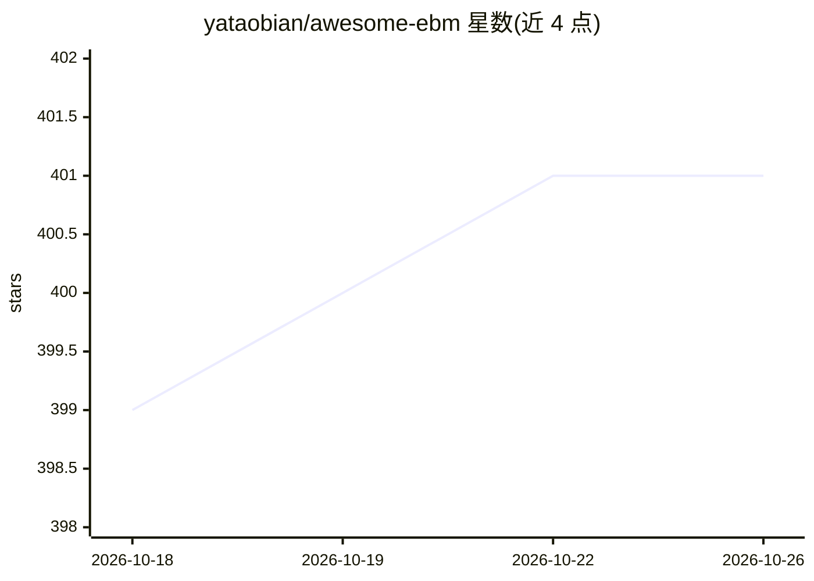

# yataobian/awesome-ebm

⭐ 401 · Shell · MIT · 推送 2026-04-22 · [GitHub](https://github.com/yataobian/awesome-ebm) · 个人维护

**能量模型（EBM）研究论文与资料聚合清单**

收录基于能量/熵的学习（Energy-Based Models）相关研究资料的策展清单：按开源库、教程与演讲、研讨会、论文（按年份倒序，覆盖 2021-2026 的 NeurIPS/ICML/ICLR/AISTATS 等会议论文）分类组织；另列出代表性应用方向（数据生成、密度估计、OOD 检测、最大熵强化学习等）。条目以链接形式指向 arXiv 论文与代码仓库，2023 及更早年份部分标注待更新。面向该方向的研究人员与研究生做文献检索使用。

## 筛选速览

| 维度 | 判定 | 备注 |
|---|---|---|
| AI 角色 | `ai-knowledge` | 知识聚合/清单类 |
| 许可风险 | `permissive` | MIT |
| 部署形态 | `None` |  |
| 模型依赖 | — | README 未给出锁定关系 |
| 硬件要求 | — | 无带数字的原话,不猜 |
| 安装摩擦 | `low` | 无编译、无系统依赖或容器化 |
| 成熟度 | — | 结构信号不足 |

## 能力要点

- 按年份倒序组织 EBM 论文条目，含会议与链接
- 收录 mini-ebm、TorchEBM、Learnergy 等开源库
- 覆盖教程、演讲、博客与研讨会资料
- 列举数据生成、密度估计、OOD 检测等代表性应用方向

## 适用场景

- 查找能量模型方向的最新论文与经典教程
- 寻找 EBM 的可用的开源实现库
- 了解 EBM 在生成、采样、鲁棒性等方向的应用

## 场景标签

`精选清单` · 领域:学习与行业

## 证据(README 行号)

> L1: # Awesome Energy Based Models/Learning (Awesome-EBM)
> L3: > A comprehensive list of energy based learning papers and materials.

## 星数曲线

2026-10-18 399 → 2026-10-26 401（+2）

---
*卡片 v1 · prompt 1.4 · 生成 2026-10-21 · 置信度 high · 依据 README sha `1ef70a9265d8` · [字段定义](../../DATASET.md)*
