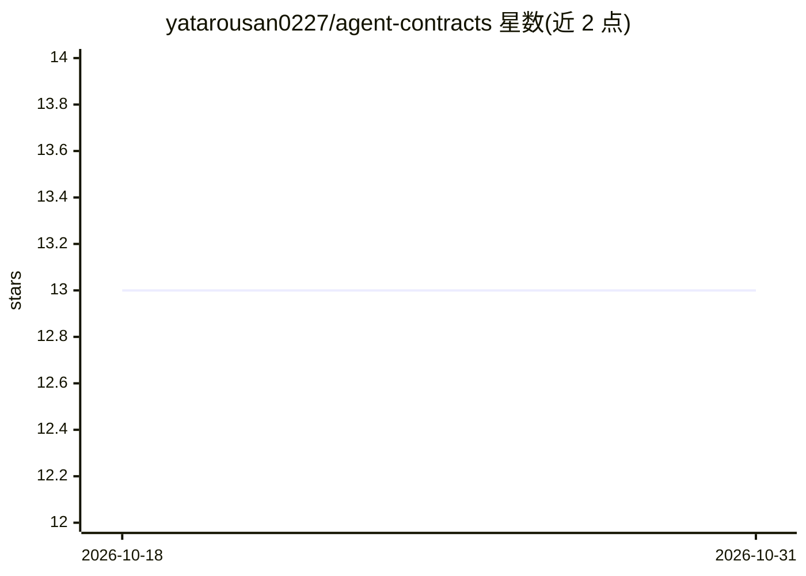

# yatarousan0227/agent-contracts

⭐ 13 · Python · MPL-2.0 · 推送 2026-02-02 · [GitHub](https://github.com/yatarousan0227/agent-contracts) · 个人维护 · 中文 README

**契约驱动的 LangGraph 多智能体构建框架，自动编译图并混合路由**

面向构建复杂多智能体系统的 Python 库：为每个 agent 节点声明 NodeContract（输入/输出/触发条件），注册后由 GraphBuilder 自动编译为可执行的 LangGraph，免手工连边。GenericSupervisor 采用规则优先、LLM 兜底的混合路由；提供 Pydantic 类型化状态、StateAccessor 安全访问、Runtime 层（含 SSE 流式）、YAML 配置、CLI 校验/可视化/diff 及 LangSmith 追踪。当前处于 Beta，1.0 前可能出现破坏性变更。不适用于简单线性聊天机器人。

## 筛选速览

| 维度 | 判定 | 备注 |
|---|---|---|
| AI 角色 | `ai-ecosystem` | LLM/agent 周边工具 |
| 许可风险 | `permissive` | MPL-2.0 |
| 部署形态 | `library` | 以包/库形式分发 |
| 模型依赖 | — | README 未给出锁定关系 |
| 硬件要求 | — | 无带数字的原话,不猜 |
| 安装摩擦 | `low` | 无编译、无系统依赖或容器化 |
| 成熟度 | `idea` | |

## 能力要点

- NodeContract 声明式定义 + GraphBuilder 自动编译 LangGraph
- 规则优先、LLM 兜底的混合 Supervisor 路由
- Runtime 层：生命周期 hooks、会话管理与 SSE 流式输出
- CLI 支持 validate / visualize / diff 契约

## 适用场景

- 我需要管理几十个 agent，路由混合业务规则与 LLM 判断
- 团队分工开发各 agent 模块，需要严格接口与类型安全
- 生产环境需要可观测的路由决策追踪

## 场景标签

`Agent 框架` `多智能体` · 领域:Agent 开发

## 证据(README 行号)

> L23: **A modular, contract-driven node architecture for building scalable LangGraph agents.**
> L63: `agent-contracts` brings **Contract-Driven Development** to LangGraph.
> L104: 3. **Build**: The **GraphBuilder** compiles the registry into a executable LangGraph.

## 星数曲线

2026-10-18 13 → 2026-10-31 13（+0）

---
*卡片 v1 · prompt 1.4 · 生成 2026-10-31 · 置信度 high · 依据 README sha `cbd8dbdbf8e6` · [字段定义](../../DATASET.md)*
