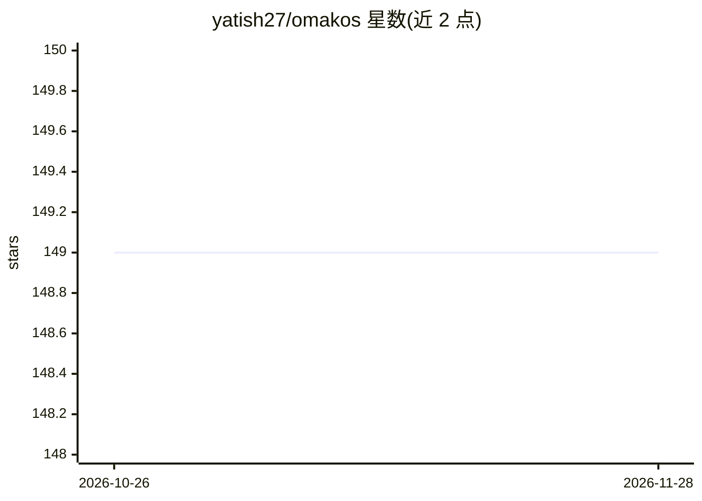

# yatish27/omakos

⭐ 149 · Shell · MIT · 推送 2026-11-25 · [GitHub](https://github.com/yatish27/omakos) · 个人维护

**一条命令把 macOS 笔记本配置成开发环境的安装脚本**

受 Basecamp Omakub 启发的 macOS 环境设置脚本：通过 Homebrew、mise 与 Mac App Store 安装并配置命令行工具、编辑器（Zed/cmux）、编程语言运行时（Python/Ruby/Rust/Go/Node/Erlang/Elixir）、数据库与一批应用，并应用一组开发者向的 macOS 系统设置与 hosts 域名屏蔽。脚本可重复运行、幂等，各模块脚本可独立执行；安装包会备份并保留既有 ~/omakos 目录的 Git 历史与本地修改。

## 筛选速览

| 维度 | 判定 | 备注 |
|---|---|---|
| AI 角色 | `ai-enhanced` | 去掉 AI 部分产品仍成立 |
| 许可风险 | `permissive` | MIT |
| 部署形态 | `library` | 以包/库形式分发 |
| 模型依赖 | local-ok | 支持本地模型 |
| 硬件要求 | — | 无带数字的原话,不猜 |
| 安装摩擦 | `medium` | 含编译或系统依赖之一 |
| 成熟度 | — | 结构信号不足 |

## 能力要点

- 单命令安装，脚本幂等可重复运行，按已装状态升级或跳过
- 模块化脚本可独立执行，Brewfile 与 configs/ 可自定义
- 通过 mise 管理多语言运行时并预置 Zed 语言服务器配置
- 提供 make lint/security/test 的仓库校验流程与 GitHub Actions CI

## 适用场景

- 新购或重装的 Mac 上一键搭建开发环境
- 统一团队笔记本的基础工具链与系统设置
- 在既有配置基础上挑选性地补装部分组件

## 场景标签

 · 领域:开发工具/环境配置

## 证据(README 行号)

> L5: > Omakos turns your macOS laptop into a fully functional development machine in a single command.
> L6: > A shell script to setup a new mac.
> L98: - Ollama for local AI models

## 星数曲线

2026-10-26 149 → 2026-11-28 149（+0）

---
*卡片 v1 · prompt 1.4 · 生成 2026-11-27 · 置信度 mid · 依据 README sha `ae48ddea1516` · [字段定义](../../DATASET.md)*
