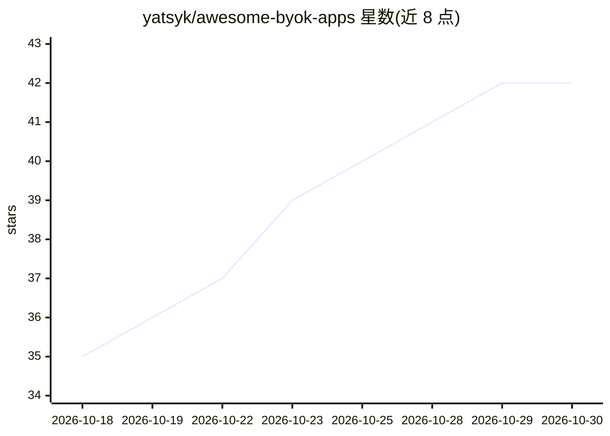

# yatsyk/awesome-byok-apps

⭐ 42 · NOASSERTION · 推送 2026-07-16 · [GitHub](https://github.com/yatsyk/awesome-byok-apps) · 个人维护

**BYOK（自带 API key）应用与 key 提供方策展清单**

一份 awesome 清单，收录可使用用户自有 AI API key 的应用，覆盖聊天 UI、代码助手、IDE/终端、写作研究、翻译、Agent 构建器、图像音频、网关代理共 8 个类别，条目均为名称加一句功能描述。另设 Providers 板块，列举 17 个可签发 API key 的模型服务商及其获取方式。清单本身不提供软件安装，按 CC0 许可发布。

## 筛选速览

| 维度 | 判定 | 备注 |
|---|---|---|
| AI 角色 | `ai-knowledge` | 知识聚合/清单类 |
| 许可风险 | `none` | NOASSERTION |
| 部署形态 | `None` |  |
| 模型依赖 | — | README 未给出锁定关系 |
| 硬件要求 | — | 无带数字的原话,不猜 |
| 安装摩擦 | `low` | 无编译、无系统依赖或容器化 |
| 成熟度 | — | 结构信号不足 |

## 能力要点

- 8 个类别的 BYOK 应用条目（聊天、代码助手、网关等）
- 17 个 API key 签发服务商清单
- 每个条目附带一句话功能说明

## 适用场景

- 挑选支持自带 API key 的聊天或编码应用
- 查找可签发 AI 模型 API key 的服务商
- 了解自建网关/代理类 BYOK 后端选项

## 场景标签

`精选清单` · 领域:学习与行业

## 证据(README 行号)

> L3: > A curated list of apps you can use with your own AI API key.
> L92: Where to get API keys.

## 星数曲线

2026-10-18 35 → 2026-10-30 42（+7）

---
*卡片 v1 · prompt 1.4 · 生成 2026-10-25 · 置信度 high · 依据 README sha `3f3401578ad2` · [字段定义](../../DATASET.md)*
