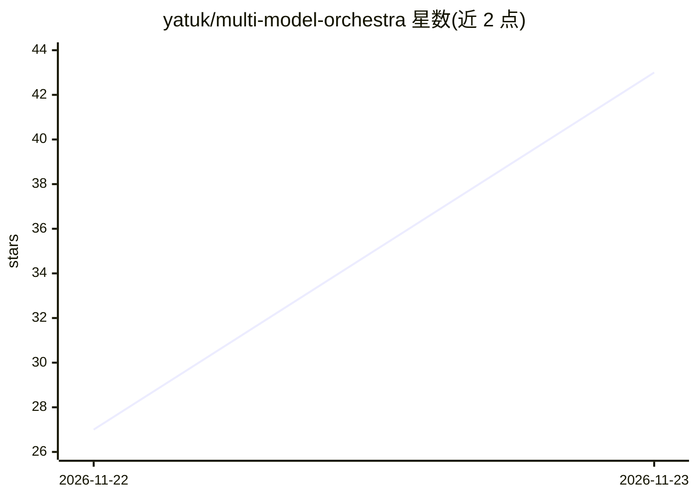

# yatuk/multi-model-orchestra

⭐ 43 · Python · MIT · 推送 2026-11-22 · [GitHub](https://github.com/yatuk/multi-model-orchestra) · 个人维护

**多模型编码任务路由技能：贵模型指挥、廉价模型干活**

一组面向 Claude Code（或任何读取 SKILL.md 的 agent）的技能集，将编码工作分派给 Claude Opus/Sonnet/Haiku、GPT、Kimi 与 DeepSeek：主 agent 规划、撰写任务简报并复核，其他模型执行。核心机制包括按难度将任务路由到能通过检查的最便宜档位、统一 runner（硬状态码与超时）、仅在 git worktree 中写入、对判断类问题召集盲评 council，以及车道基准测试。依赖 bash、git、timeout 与 Python 3，Windows 需 Git Bash。

## 筛选速览

| 维度 | 判定 | 备注 |
|---|---|---|
| AI 角色 | `ai-ecosystem` | LLM/agent 周边工具 |
| 许可风险 | `permissive` | MIT |
| 部署形态 | `None` |  |
| 模型依赖 | locked-api |  |
| 硬件要求 | — | 无带数字的原话,不猜 |
| 安装摩擦 | `low` | 无编译、无系统依赖或容器化 |
| 成熟度 | — | 结构信号不足 |

## 能力要点

- 按难度路由：车道只有未通过检查才升档，而非凭直觉
- 统一 runner mmo-run：每个调用带硬状态码与超时，写入仅限 git worktree
- 盲评 council 处理判断类问题， conductor 自行跑检查并读完整 diff
- 附车道基准与 A/B 成本对比（约 40% 成本降低，单次运行）

## 适用场景

- 让廉价模型执行编码任务并由贵模型复核，控制 API 开销
- 在合并前请 GPT 对迁移方案给第二意见
- otomode 模式下数小时无人值守批量执行任务并以测试把关

## 场景标签

`多智能体` `编码 Agent` `模型评测` · 领域:Agent 开发

## 证据(README 行号)

> L8: Skills for Claude Code (or anything that reads <code>SKILL.md</code> files) that hand work to Claude Opus, Sonnet an
> L29:  <code>mmo-run</code> is the one runner for every provider, with hard status codes and a timeout on every call. Wri
> L23:  Each job goes to the cheapest tier that can pass its check, by difficulty. A lane moves up only after it fails the

## 星数曲线

2026-11-22 27 → 2026-11-23 43（+16）

---
*卡片 v1 · prompt 1.4 · 生成 2026-11-22 · 置信度 high · 依据 README sha `3b6f991d0945` · [字段定义](../../DATASET.md)*
