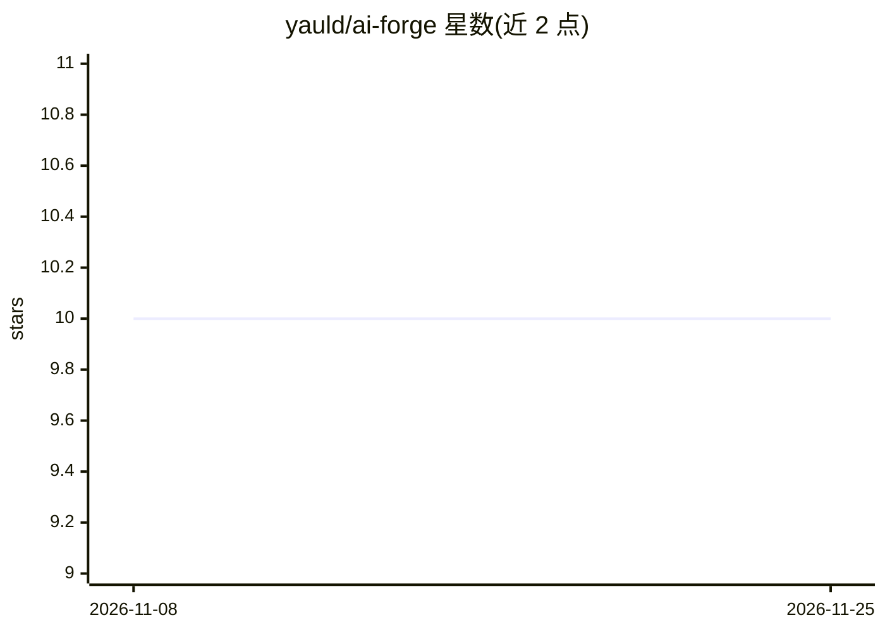

# yauld/ai-forge

⭐ 10 · Jupyter Notebook · 推送 2026-08-12 · [GitHub](https://github.com/yauld/ai-forge) · 个人维护 · 中文 README

**AI 工程实战学习仓库：Notebook 实验覆盖微调/RAG/MCP**

以文章、Notebook 和可运行实验组织的学习仓库，专题涵盖 LangChain、LangGraph（27 个实验）、RAG、MCP、Sec for AI、Skills、Model（Qwen3-1.7B LoRA 微调全流程）与编码基础。每个专题有 README 提供学习路线与内容入口，实验可本地复现：需 Python 3.13+ 并用 uv 管理依赖；也可仅在线阅读，无需本地环境。维护者另运营公众号发布聚焦版本。

## 筛选速览

| 维度 | 判定 | 备注 |
|---|---|---|
| AI 角色 | `ai-knowledge` | 知识聚合/清单类 |
| 许可风险 | `none` | — |
| 部署形态 | `None` |  |
| 模型依赖 | — | README 未给出锁定关系 |
| 硬件要求 | — | 无带数字的原话,不猜 |
| 安装摩擦 | `low` | 无编译、无系统依赖或容器化 |
| 成熟度 | — | 结构信号不足 |

## 能力要点

- 7 个专题：LangChain/LangGraph/RAG/MCP/Sec for AI/Skills/Model
- LangGraph 已完成 27 个实验主题，含持久化与多 Agent
- 含一次 Qwen3-1.7B LoRA 微调实验（训练到部署）
- uv 管理依赖，Notebook 可直接在线阅读

## 适用场景

- 系统学习 LangChain/LangGraph 的工程化用法
- 复现从数据准备到部署的 LoRA 微调链路
- 了解 MCP 协议与 Agent 应用层安全问题

## 场景标签

`教程课程` · 领域:学习与行业

## 证据(README 行号)

> L5: 这个仓库通过文章、Notebook 和可运行实验，持续研究模型微调、LangChain、LangGraph、RAG、MCP、Sec for AI、Agent 工程化、记忆、工具调用与安全控制。每个专题的 README 提供专题介绍、
> L136: 如果你希望运行 Notebook 或复现示例，本仓库要求 Python 3.13 或更高版本，并使用 uv 管理依赖：

## 星数曲线

2026-11-08 10 → 2026-11-25 10（+0）

---
*卡片 v1 · prompt 1.4 · 生成 2026-11-19 · 置信度 high · 依据 README sha `6b3308f9ab22` · [字段定义](../../DATASET.md)*
