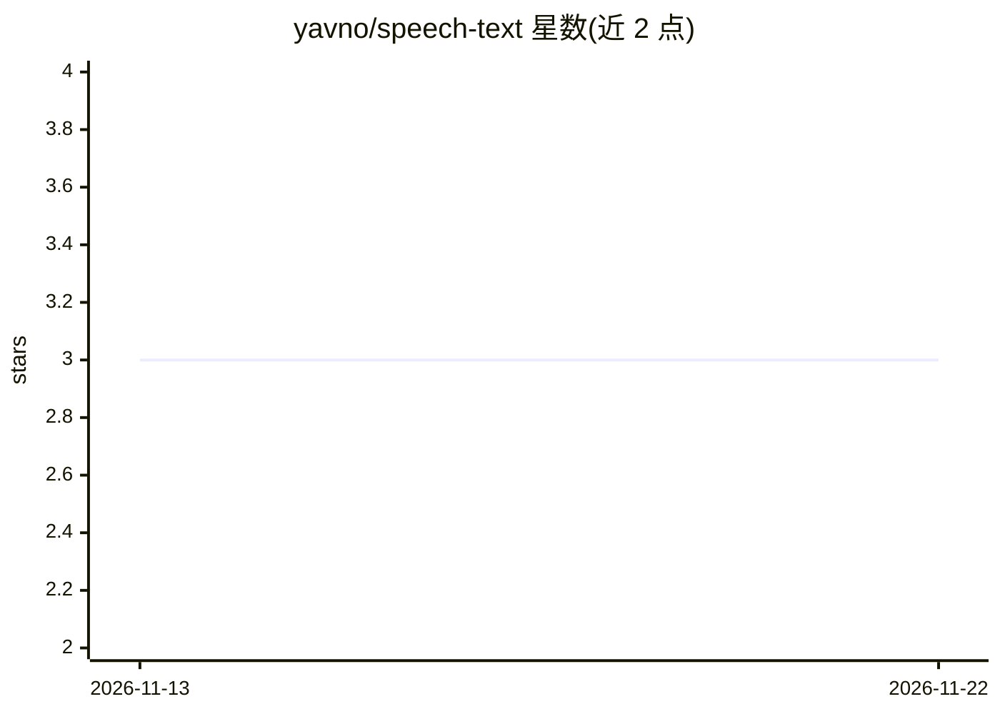

# yavno/speech-text

⭐ 3 · Swift · GPL-3.0 · 推送 2026-11-19 · [GitHub](https://github.com/yavno/speech-text) · [官网](https://speech-text.app/) · 个人维护

**macOS 全局语音输入工具：按键说话，文字落至光标处**

macOS 菜单栏应用：按住快捷键说话，松开后转写文本直接插入当前光标所在应用。另支持 AI 改写模式（将口语整理为消息/邮件等指定格式）与选中文本的语音改写。运行方式两种：本机下载语音模型离线运行（免费、本地处理），或接入用户自备的 Groq/OpenAI/ElevenLabs/Anthropic API key 走云端。无账号、无遥测，历史记录存本地，按用户设定保留时长。通过 DMG 或 Homebrew 安装，要求 macOS 14+，当前为 beta。

## 筛选速览

| 维度 | 判定 | 备注 |
|---|---|---|
| AI 角色 | `ai-native` | 本体是模型或模型工具 |
| 许可风险 | `viral` | GPL-3.0 |
| 部署形态 | `desktop` | 安装包/桌面程序 |
| 模型依赖 | — | README 未给出锁定关系 |
| 硬件要求 | — | 无带数字的原话,不猜 |
| 安装摩擦 | `low` | 无编译、无系统依赖或容器化 |
| 成熟度 | `idea` | |

## 能力要点

- 按住快捷键说话，转写文本直接出现在光标位置
- 语音改写：将口语整理为指定格式，或对选中文本下指令改写
- 本机语音模型一键下载，离线运行，支持英语、乌克兰语等数十种语言
- 自备 API key 接入云端（Groq/OpenAI/ElevenLabs/Anthropic），无账号无遥测

## 适用场景

- 在任意应用中用语音代替打字输入
- 口述口语内容后让 AI 整理成消息或邮件
- 离线环境下本地转写，音频不出电脑
- 用语音修正选中文本的语气或长度

## 场景标签

`语音识别` `AI 写作` · 领域:内容生成

## 证据(README 行号)

> L5: Press a shortcut, say what you want to write, and the text appears at your cursor: in Slack, Mail, Notion, your code
> L35: - **On your Mac:** download a speech model in one click. It's free and private, works offline, and handles English,
> L36: - **In the cloud:** use your own Groq, OpenAI, ElevenLabs or Anthropic key. A month of heavy dictation costs cents,

## 星数曲线

2026-11-13 3 → 2026-11-22 3（+0）

---
*卡片 v1 · prompt 1.4 · 生成 2026-11-21 · 置信度 high · 依据 README sha `3f4310f9b1f5` · [字段定义](../../DATASET.md)*
