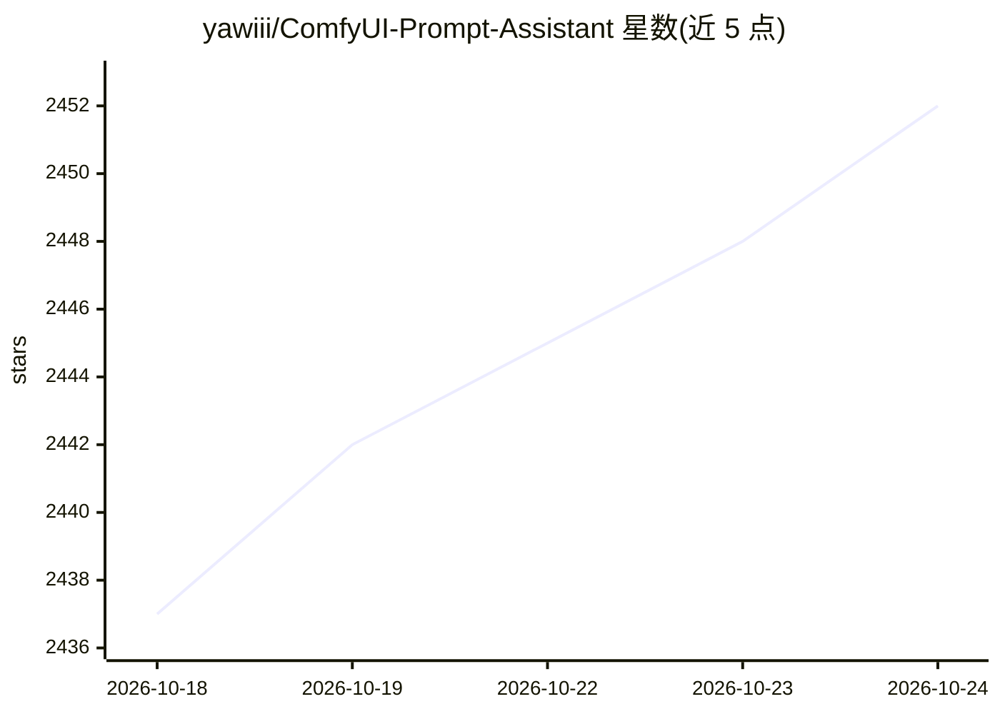

# yawiii/ComfyUI-Prompt-Assistant

⭐ 2,456 · JavaScript · GPL-3.0 · 推送 2026-04-25 · [GitHub](https://github.com/yawiii/ComfyUI-Prompt-Assistant) · [官网](https://space.bilibili.com/520680644) · 个人维护 · 中文 README

**ComfyUI 提示词插件：调用云端/本地大模型做翻译、扩写与图像反推**

面向 ComfyUI 用户的提示词辅助插件，通过云端大模型 API（智谱、xFlow 聚合、百度翻译等）或本地 Ollama 调用 LLM/VLM，实现提示词翻译与优化扩写、图像反推提示词、视频反推、Markdown 与节点文档翻译；另提供标签/短语收藏预设、历史记录与撤销重做、API Key 本地存储。以自定义节点形式安装（Manager / git clone / 压缩包），适配 ComfyUI node2.0 与 V3 API，支持自定义服务商与多模型备选。

## 筛选速览

| 维度 | 判定 | 备注 |
|---|---|---|
| AI 角色 | `ai-native` | 本体是模型或模型工具 |
| 许可风险 | `viral` | GPL-3.0 |
| 部署形态 | `None` |  |
| 模型依赖 | local-ok | 支持本地模型 |
| 硬件要求 | — | 无带数字的原话,不猜 |
| 安装摩擦 | `low` | 无编译、无系统依赖或容器化 |
| 成熟度 | `idea` | |

## 能力要点

- 支持云端 LLM API 与本地 Ollama，翻译/扩写/反推可独立选择服务
- 图像与视频反推提示词节点，支持多种反推风格
- 标签、短语、Lora 触发词收藏与多套标签切换
- 历史记录、撤销重做与翻译缓存

## 适用场景

- 在 ComfyUI 中把中文想法翻译或扩写成提示词
- 从图片/视频反推生成提示词
- 收藏常用标签与触发词实现一键插入

## 场景标签

`提示工程` · 领域:Agent 开发

## 证据(README 行号)

> L12: > 支持调用云端大模型API、本地Ollama大模型。实现提示词、Markdown节点、节点文档翻译；提示词优化、图像反推和视频反推；常用标签收藏、历史记录等功能。是一个全能all in one的提示词插件！
> L197: `在图像节点上快速实现将图片反推成提示词，支持（中/英），支持多种反推风格（如自然语言、Tag风格...）`
> L317: `速度快，无限额度；注意：模型有审查，如果请求内容违规，会返回空结果。并非插件bug。最近智谱开始限制请求频率了。`

## 星数曲线

2026-10-18 2,437 → 2026-10-24 2,452（+15）

---
*卡片 v1 · prompt 1.4 · 生成 2026-10-21 · 置信度 high · 依据 README sha `e1aec3a9fc55` · [字段定义](../../DATASET.md)*
