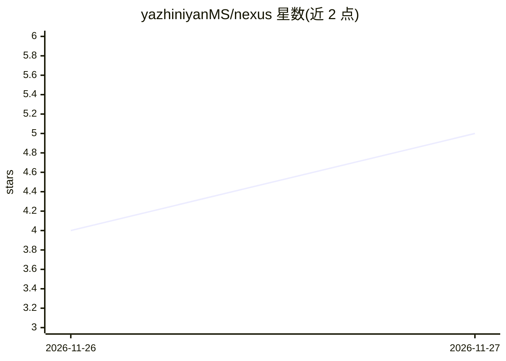

# yazhiniyanMS/nexus

⭐ 5 · Rust · MIT · 推送 2026-11-25 · [GitHub](https://github.com/yazhiniyanMS/nexus) · [官网](https://yazhiniyanms.github.io/nexus/) · 个人维护

**本地优先的桌面代码库理解工作台，AI 改动需人工审批**

基于 Tauri 2（Rust 核心 + React 19）的开源桌面应用，覆盖 macOS/Windows/Linux。无需 AI 与 API key 即可对本地项目构建索引，输出架构图、依赖环、热点文件、符号引用与可分享 HTML 报告（不含源码，支持 Mermaid 导出）。AI 部分：Agent 在隔离 Git worktree 中执行研究—计划—实现—测试—评审，每条命令与最终 diff 均需用户批准，命令可沙箱化运行；模型可接 Ollama、llama.cpp、LM Studio 或 Anthropic/OpenAI，Model Lab 提供本地基准对比。Agents 与 Model Lab 标注为实验性；Windows 沙箱目前仅支持 Trusted 级别。

## 筛选速览

| 维度 | 判定 | 备注 |
|---|---|---|
| AI 角色 | `ai-enhanced` | 去掉 AI 部分产品仍成立 |
| 许可风险 | `permissive` | MIT |
| 部署形态 | `desktop` | 安装包/桌面程序 |
| 模型依赖 | local-ok | 支持本地模型 |
| 硬件要求 | — | 无带数字的原话,不猜 |
| 安装摩擦 | `low` | 无编译、无系统依赖或容器化 |
| 成熟度 | — | 结构信号不足 |

## 能力要点

- 无需 AI 与 API key 的代码索引：架构图、依赖环、热点、符号引用
- Agent 改动在隔离 Git worktree 进行，计划/命令/diff 逐级审批
- 命令沙箱三级执行（Trusted/Restricted/Isolated），凭据以占位符发送
- 可分享 HTML 报告不含源码，地图可导出 Mermaid

## 适用场景

- 快速看懂陌生代码库的模块结构与依赖环
- 让 AI Agent 在隔离副本中改代码，逐步审批后再落地
- 生成不含源码的架构报告分享给团队
- 在本地对比多个模型在自己硬件上的表现

## 场景标签

`编码 Agent` `模型评测` · 领域:编码与开发

## 证据(README 行号)

> L5: An open-source desktop workspace for macOS, Windows and Linux. It maps any local project without AI,
> L28: - **Agents that ask first.** An agent researches, plans, writes in a separate Git worktree, runs tests and reviews 
> L103: A Tauri 2 app: a Rust core (SQLite, Git, pseudo-terminals, process sandboxing, the code index and the agent engine

## 星数曲线

2026-11-26 4 → 2026-11-27 5（+1）

---
*卡片 v1 · prompt 1.4 · 生成 2026-11-26 · 置信度 high · 依据 README sha `2740c6f462f1` · [字段定义](../../DATASET.md)*
