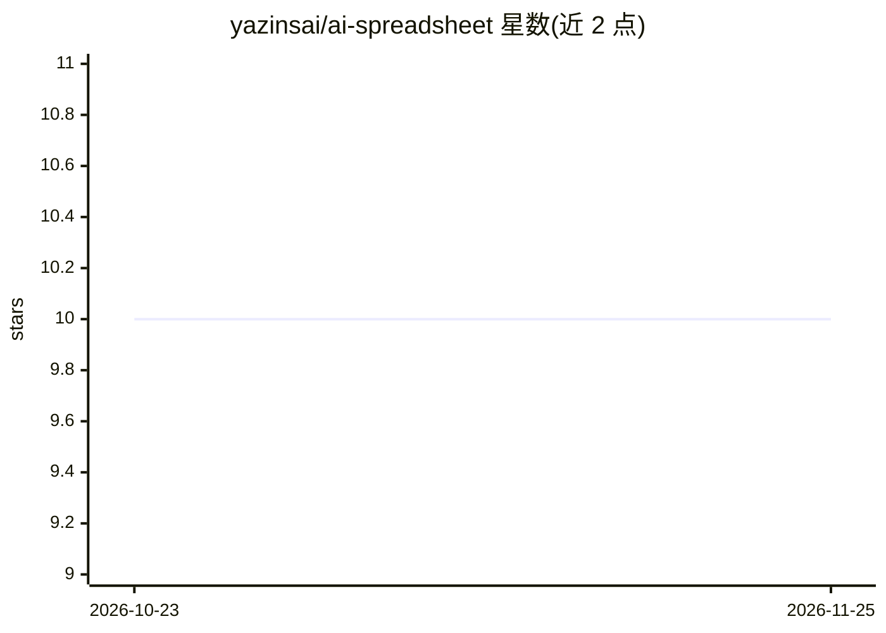

# yazinsai/ai-spreadsheet

⭐ 10 · TypeScript · 推送 2026-11-10 · [GitHub](https://github.com/yazinsai/ai-spreadsheet) · [官网](https://spreadsheet.yaz.in) · 个人维护

**给需要批量处理表格数据的人用的 AI 公式电子表格**

运行在浏览器中的电子表格应用，核心机制是 =AI("提示词") 公式，可引用 {{列名}} 让整列数据批量执行提取、分类、翻译、摘要、内容生成等 LLM 任务，运行前显示预估成本。AI 调用经 OpenRouter API 完成，默认模型 gpt-4o-mini，可指定其他模型。数据全部存于浏览器本地（IndexedDB），无后端服务器。通过 git clone 源码并以 npm 运行，需 Node.js 18+。

## 筛选速览

| 维度 | 判定 | 备注 |
|---|---|---|
| AI 角色 | `ai-native` | 本体是模型或模型工具 |
| 许可风险 | `none` | — |
| 部署形态 | `library` | 以包/库形式分发 |
| 模型依赖 | locked-api |  |
| 硬件要求 | — | 无带数字的原话,不猜 |
| 安装摩擦 | `low` | 无编译、无系统依赖或容器化 |
| 成熟度 | — | 结构信号不足 |

## 能力要点

- =AI() 公式语法，支持 {{列名}} 引用与模板保存
- 经 OpenRouter 接入多模型，默认 gpt-4o-mini
- CSV 导入/导出，结果可随数据一并保存
- 纯浏览器本地运行，无后端，数据与 API key 存本地

## 适用场景

- 批量分析客户评论的情感与主要诉求
- 清洗混乱的联系人数据（姓名/电话/邮箱）
- 根据产品信息批量生成营销文案与 SEO 标题

## 场景标签

`数据分析` · 领域:效率与自动化

## 证据(README 行号)

> L1: # AI Sheet - Smart Spreadsheet with AI Formulas
> L3: A powerful spreadsheet application that lets you use AI to transform and analyze your data. Think of it as Excel mee
> L55: =AI("Your prompt here")

## 星数曲线

2026-10-23 10 → 2026-11-25 10（+0）

---
*卡片 v1 · prompt 1.4 · 生成 2026-11-19 · 置信度 high · 依据 README sha `1e2dacd1d33d` · [字段定义](../../DATASET.md)*
