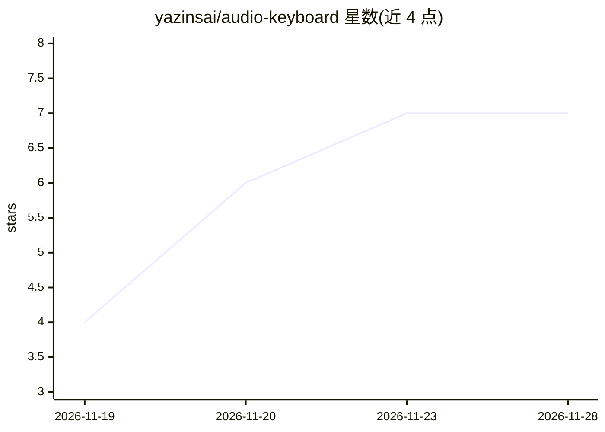

# yazinsai/audio-keyboard

⭐ 7 · Kotlin · NOASSERTION · 推送 2026-11-18 · [GitHub](https://github.com/yazinsai/audio-keyboard) · 个人维护

**面向 Android 用户的 AI 键盘：仿 Gboard 手感并生成回复与听写**

一款 Android 输入法应用，键盘部分提供滑动输入、英文与阿拉伯文的建议词/联想/自动纠错、剪贴板历史与个人词典等基础功能。AI 部分通过配置的服务接入：根据语音指令生成消息、逐字听写、为已记忆的聊天预先起草三条回复，并为每个聊天维护记忆与写作风格学习。AI 功能默认关闭，需 Venice AI API key 或自建 OpenAI 兼容服务方可使用；需 Android 10+。

## 筛选速览

| 维度 | 判定 | 备注 |
|---|---|---|
| AI 角色 | `ai-native` | 本体是模型或模型工具 |
| 许可风险 | `none` | NOASSERTION |
| 部署形态 | `None` |  |
| 模型依赖 | — | README 未给出锁定关系 |
| 硬件要求 | — | 无带数字的原话,不猜 |
| 安装摩擦 | `low` | 无编译、无系统依赖或容器化 |
| 成熟度 | `idea` | |

## 能力要点

- 语音指令直接生成消息，结合屏幕上下文
- 逐字听写，分块传输并支持断网重试
- 每个聊天独立的记忆面板与三条预生成回复
- 英文与阿拉伯文的滑动输入、自动纠错与 RTL 布局

## 适用场景

- 在聊天应用中让键盘预先起草回复再选用
- 用语音口述指令让键盘代写或改写消息
- 需要英文/阿拉伯文双语键盘与听写的日常输入

## 场景标签

`AI 助手` `语音识别` `AI 写作` · 领域:对话与助手

## 证据(README 行号)

> L17: - **It replies before you ask.** Open a chat and three replies are already waiting in the suggestion strip, written
> L19: - **You say what you mean, it writes the message.** Tap ✦ and speak an instruction ("tell her Thursday works and as
> L37: |**✦ Prompt**|Speech as an instruction. "Make it shorter", "say no politely", "what's 15% of 80": the result goes s

## 星数曲线

2026-11-19 4 → 2026-11-28 7（+3）

---
*卡片 v1 · prompt 1.4 · 生成 2026-11-20 · 置信度 high · 依据 README sha `bdb78ba761a5` · [字段定义](../../DATASET.md)*
