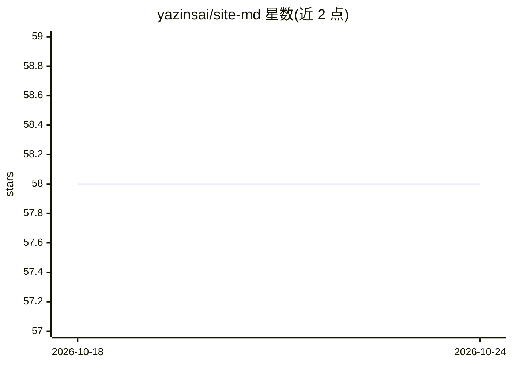

# yazinsai/site-md

⭐ 58 · TypeScript · MIT · 推送 2026-04-21 · [GitHub](https://github.com/yazinsai/site-md) · [官网](https://www.npmjs.com/package/site-md) · 个人维护

**让 Next.js 站点对 AI 爬虫与 Agent 输出干净 Markdown 的中间件**

面向 Next.js 站点维护者的内容协商工具：人类访客继续收到 HTML，AI agent、爬虫与 LLM 通过 .md 后缀、?format=md、Accept: text/markdown 头或已知 bot User-Agent（GPTBot、ClaudeBot 等）收到同一页面的 Markdown 版本。通过 npx site-md 一条命令安装，自动写入 middleware.ts、App Router 路由并包装 next.config；自动生成 /llms.txt 与 /llms-full.txt 站点索引。内部自抓取剥离 cookies 与认证，仅转换公开内容。MIT 许可。

## 筛选速览

| 维度 | 判定 | 备注 |
|---|---|---|
| AI 角色 | `ai-ecosystem` | LLM/agent 周边工具 |
| 许可风险 | `permissive` | MIT |
| 部署形态 | `library` | 以包/库形式分发 |
| 模型依赖 | — | README 未给出锁定关系 |
| 硬件要求 | — | 无带数字的原话,不猜 |
| 安装摩擦 | `low` | 无编译、无系统依赖或容器化 |
| 成熟度 | — | 结构信号不足 |

## 能力要点

- 按路径后缀、查询参数、Accept 头、bot UA 四类触发条件判定 agent 请求
- npx site-md 一条命令自动写入 middleware 并 AST 合并已有配置
- 自动生成 /llms.txt 与 /llms-full.txt 站点 Markdown 索引
- 自抓取剥离 cookies/auth，仅转换公开内容并带防循环 bypass 头

## 适用场景

- 让自己的文档站/博客对 LLM 爬虫提供干净 Markdown
- 为站点生成 llms.txt 供 AI agent 发现内容
- 按 bot 类别配置返回 Markdown、403 或原样 HTML

## 场景标签

 · 领域:Web 开发/AI 内容交付

## 证据(README 行号)

> L1: site-md converts your Next.js pages to clean Markdown for AI agents
> L5:  Serve clean Markdown from your Next.js site — for AI agents, crawlers, and LLMs.
> L9:  <code>npx site-md</code> — installs, wires up middleware, merges your next.config. No content duplication. No rewri

## 星数曲线

2026-10-18 58 → 2026-10-24 58（+0）

---
*卡片 v1 · prompt 1.4 · 生成 2026-10-24 · 置信度 high · 依据 README sha `306be46de04e` · [字段定义](../../DATASET.md)*
