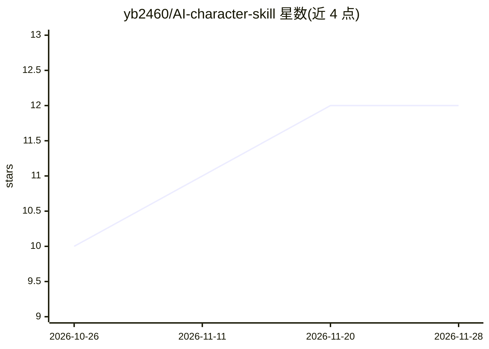

# yb2460/AI-character-skill

⭐ 12 · Java · NOASSERTION · 推送 2026-06-03 · [GitHub](https://github.com/yb2460/AI-character-skill) · 个人维护 · 中文 README

**将公众人物蒸馏为 Claude Code 对话智能体的角色技能合集**

通过 dot-skill 蒸馏框架，对公众人物的公开言论、决策记录与表达风格做 6 维度研究，提取心智模型、决策启发式与语言指纹，生成带证据锚点的 7 层人格架构技能，在 Claude Code 中以斜杠命令触发对话。收录 13 个 Claude Code 角色技能（张雪峰、濑户环奈、Elon Musk 等），另提供网页版 App 角色（6 个投资大师，基于 virattt/ai-hedge-fund 蒸馏）。git clone 仓库即可安装；声明仅供学习研究、禁商用，角色不代表原型人物观点。

## 筛选速览

| 维度 | 判定 | 备注 |
|---|---|---|
| AI 角色 | `ai-native` | 本体是模型或模型工具 |
| 许可风险 | `none` | NOASSERTION |
| 部署形态 | `None` |  |
| 模型依赖 | locked-api |  |
| 硬件要求 | — | 无带数字的原话,不猜 |
| 安装摩擦 | `low` | 无编译、无系统依赖或容器化 |
| 成熟度 | — | 结构信号不足 |

## 能力要点

- 6 维度研究与 7 层人格架构的角色蒸馏方法
- 13 个 Claude Code 角色技能，斜杠命令触发
- 网页版角色 App，添加到主屏幕即用
- 投资大师角色基于 ai-hedge-fund 项目蒸馏

## 适用场景

- 以张雪峰的视角咨询高考志愿问题
- 和濑户环奈等角色进行日常对话
- 研究角色人格蒸馏与技能构建方式

## 场景标签

`聊天机器人` · 领域:对话与助手

## 证据(README 行号)

> L3: > 🎭 使用 AI 蒸馏技术，将公众人物"炼"成可对话的 Claude Code 智能体 | Distill public figures into conversational AI agents
> L9: **AI Character Skill** 做的就是这件事。通过 `dot-skill` 蒸馏框架，对公众人物的公开言论、决策记录、表达风格进行 **6维度系统研究**，提取其心智模型、决策启发式和语言指纹，生成一个能以角色原型思
> L15: **AI Character Skill** makes this possible. Using the `dot-skill` distillation framework, we systematically researc

## 星数曲线

2026-10-26 10 → 2026-11-28 12（+2）

---
*卡片 v1 · prompt 1.4 · 生成 2026-11-18 · 置信度 high · 依据 README sha `e6a016746108` · [字段定义](../../DATASET.md)*
