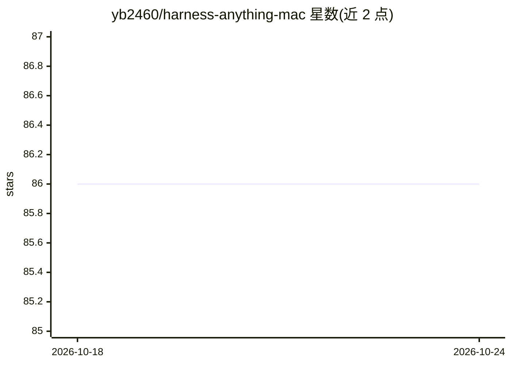

# yb2460/harness-anything-mac

⭐ 86 · Python · 推送 2026-06-12 · [GitHub](https://github.com/yb2460/harness-anything-mac) · 个人维护 · 中文 README

**供 AI Agent 调用的办公/设计软件 COM 操控 CLI 工具集**

包含五个子项目：cli-anything-wps 通过 COM 接口以 47 个 CLI 命令操控 WPS/Microsoft Office 的文字、表格与演示文稿并支持多格式导出；cli-anything-zotero 集成 Zotero 文献管理与 27 个学术 Skill；Illustrator Harness 与 Photoshop Harness 分别通过 Windows COM 操控 Adobe Illustrator/Photoshop 进行矢量与位图创建编辑；另有 5 个 JSON 数据驱动的 WPS PPT 自动生成项目。以 Python CLI 形式提供，主要依赖 Windows 环境与对应宿主软件（WPS/Office/Adobe/Zotero）。

## 筛选速览

| 维度 | 判定 | 备注 |
|---|---|---|
| AI 角色 | `ai-ecosystem` | LLM/agent 周边工具 |
| 许可风险 | `none` | — |
| 部署形态 | `library` | 以包/库形式分发 |
| 模型依赖 | — | README 未给出锁定关系 |
| 硬件要求 | — | 无带数字的原话,不猜 |
| 安装摩擦 | `low` | 无编译、无系统依赖或容器化 |
| 成熟度 | — | 结构信号不足 |

## 能力要点

- 47 个 CLI 命令操控 WPS/MS Office 文档并导出多种格式
- COM Bridge 操控 Adobe Illustrator/Photoshop 的图层、形状、文字与导出
- Zotero 集成 27 个学术 Skill，覆盖检索/写作/审稿/分析等 7 类
- JSON 数据驱动全自动生成 PPT（5 校招生数据示例）

## 适用场景

- 让 AI Agent 通过命令批量操作 Word/Excel/PPT 文档
- 让 AI Agent 在 Illustrator/Photoshop 中创建与编辑图形
- 结合 Zotero 自动化文献检索与论文写作流程

## 场景标签

`GUI 自动化` `科研工具` · 领域:效率与自动化

## 证据(README 行号)

> L3:  AI Agent 工具集 —— 办公 + 设计 + 学术 全栈操控
> L48: ### 3. Illustrator Harness — Adobe Illustrator AI Agent

## 星数曲线

2026-10-18 86 → 2026-10-24 86（+0）

---
*卡片 v1 · prompt 1.4 · 生成 2026-10-23 · 置信度 mid · 依据 README sha `f0b4e4d14c90` · [字段定义](../../DATASET.md)*
