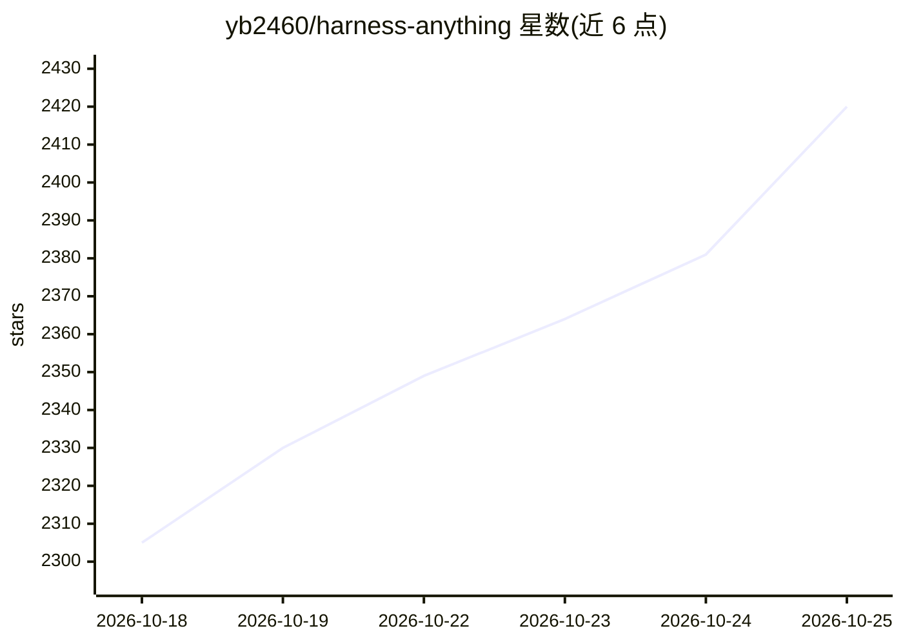

# yb2460/harness-anything

⭐ 2,420 · Python · MIT · 推送 2026-10-09 · [GitHub](https://github.com/yb2460/harness-anything) · 个人维护 · 中文 README

**让 AI Agent 操控办公/设计/学术软件的 Windows COM 工具集**

面向 Windows 的 AI Agent 工具集，通过 COM 自动化接口与 CLI 命令操控 WPS/Microsoft Office（Word/Excel/PowerPoint，47 个命令）、Adobe Illustrator 与 Photoshop（文档/图层/形状/文字/导出），并集成 Zotero 学术技能集（7 类 27 个 Skill，覆盖检索、写作、审稿、可视化、流水线）。另含 JSON 数据驱动的 WPS PPT 生成引擎 pptengine，路径无关、克隆即可运行，内置规避 7 个 WPS COM 兼容问题。运行需 Windows 10/11、对应宿主软件与 Python 3.10+ + pywin32。

## 筛选速览

| 维度 | 判定 | 备注 |
|---|---|---|
| AI 角色 | `ai-ecosystem` | LLM/agent 周边工具 |
| 许可风险 | `permissive` | MIT |
| 部署形态 | `library` | 以包/库形式分发 |
| 模型依赖 | — | README 未给出锁定关系 |
| 硬件要求 | — | 无带数字的原话,不猜 |
| 安装摩擦 | `low` | 无编译、无系统依赖或容器化 |
| 成熟度 | — | 结构信号不足 |

## 能力要点

- 47 个 CLI 命令通过 COM 操控 WPS/Microsoft Office 三件套
- Illustrator/Photoshop Harness 供 AI Agent 创建编辑矢量与位图
- Zotero 7 类 27 个学术 Skill（检索/写作/审稿/可视化/流水线）
- pptengine：JSON/代码驱动生成 PPT，PyMuPDF 落盘校验文本溢出

## 适用场景

- 让 AI Agent 直接读写操作 Office 文档与幻灯片
- 搭建自动化生成学术 PPT/海报的流水线
- 通过 CLI 批量操控 Illustrator/Photoshop 完成设计任务

## 场景标签

`GUI 自动化` `工作流自动化` `科研工具` · 领域:效率与自动化

## 证据(README 行号)

> L3:  AI Agent 工具集 —— 办公 + 设计 + 学术 全栈操控
> L13: 47 个 CLI 命令，通过 COM 自动化接口操控 WPS Office 或 Microsoft Office（Word/Excel/PowerPoint）。
> L50: 通过 Windows COM 自动化接口操控 **Adobe Illustrator**，让 AI Agent 直接创建和编辑矢量图形。
> L134: 通过 Windows COM 自动化接口操控 **Adobe Photoshop**，让 AI Agent 直接创建和编辑位图图像。

## 星数曲线

2026-10-18 2,305 → 2026-10-25 2,420（+115）

---
*卡片 v1 · prompt 1.4 · 生成 2026-10-21 · 置信度 high · 依据 README sha `70f83ece65a1` · [字段定义](../../DATASET.md)*
