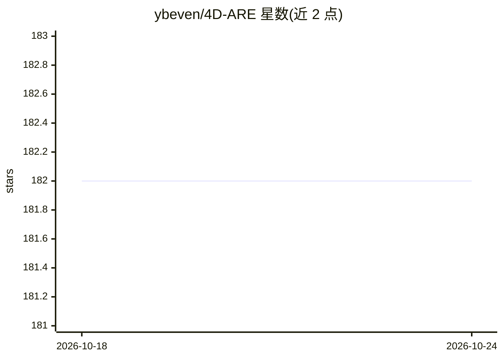

# ybeven/4D-ARE

⭐ 182 · Python · MIT · 推送 2026-10-03 · [GitHub](https://github.com/ybeven/4D-ARE) · 个人维护

**让 LLM agent 输出因果解释的归因需求工程框架**

基于 4D-ARE 论文的 Python 框架，用于构建能追溯因果链而非仅罗列指标的 LLM agent：将分析按结果、过程、支撑、长期四个维度组织，并为各维度设定权限级别与边界。通过 OPENAI_API_KEY 调用模型，支持 MCP 接入 MySQL 等真实数据源，内置银行、医疗、电商领域模板，可通过 pip 安装并提供 CLI（demo 等命令）。设计时而非运行时解决归因问题。

## 筛选速览

| 维度 | 判定 | 备注 |
|---|---|---|
| AI 角色 | `ai-ecosystem` | LLM/agent 周边工具 |
| 许可风险 | `permissive` | MIT |
| 部署形态 | `library` | 以包/库形式分发 |
| 模型依赖 | — | README 未给出锁定关系 |
| 硬件要求 | — | 无带数字的原话,不猜 |
| 安装摩擦 | `low` | 无编译、无系统依赖或容器化 |
| 成熟度 | — | 结构信号不足 |

## 能力要点

- 4 维因果链分析（结果/过程/支撑/长期）并设定各维度权限级别与边界
- 预置银行、医疗、电商领域模板，支持自定义领域模板
- 通过 MCP 接入 MySQL 等真实数据源
- 提供 Python API 与 CLI（four-d-are demo）

## 适用场景

- 构建能解释业务指标背后原因的 LLM agent
- 为医疗、银行、电商领域定制归因分析 agent
- 接入自有数据库让 agent 基于真实数据做因果解释

## 场景标签

`Agent 框架` · 领域:Agent 开发

## 证据(README 行号)

> L28: 4D-ARE provides a framework for building agents that trace causal chains through 4 dimensions:
> L108: 4D-ARE solves the attribution gap at **design time**, not runtime:

## 星数曲线

2026-10-18 182 → 2026-10-24 182（+0）

---
*卡片 v1 · prompt 1.4 · 生成 2026-10-23 · 置信度 high · 依据 README sha `c7b6eca3af1b` · [字段定义](../../DATASET.md)*
