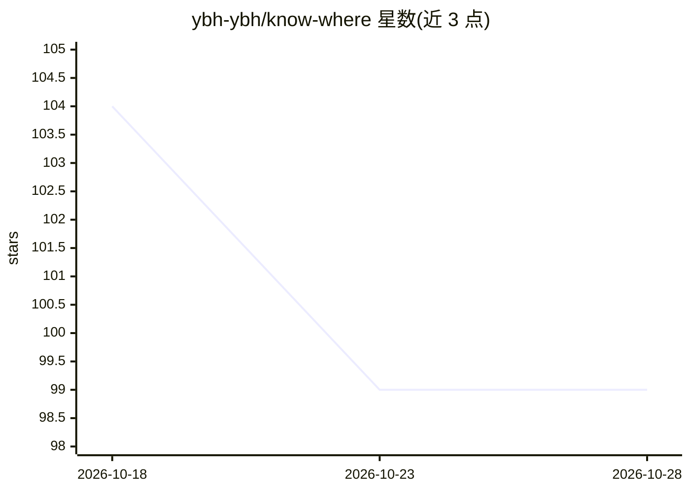

# ybh-ybh/know-where

⭐ 99 · Python · Apache-2.0 · 推送 2026-10-23 · [GitHub](https://github.com/ybh-ybh/know-where) · [官网](https://ybh-ybh.github.io/know-where/) · 个人维护 · 中文 README

**自托管飞书机器人：把内容链接经 AI 分类总结归档到多维表格**

面向个人使用的自托管 AI 知识归档工具。用户把微信公众号、稀土掘金、GitHub、小红书、抖音、B站链接通过飞书私聊发给机器人，知归自动提取正文/README/图文/视频音频，用 AI 生成简短标题、分类、标签与摘要，归档到飞书多维表格；图文经视觉模型理解，视频默认用本地 faster-whisper 转录（可切腾讯云 ASR）。通过 Docker Compose 部署，需自备 PostgreSQL、飞书企业自建应用和 OpenAI 兼容文本模型；只处理公开内容，一条消息只处理一个链接。

## 筛选速览

| 维度 | 判定 | 备注 |
|---|---|---|
| AI 角色 | `ai-native` | 本体是模型或模型工具 |
| 许可风险 | `permissive` | Apache-2.0 |
| 部署形态 | `self-host` | docker 或自建部署 |
| 模型依赖 | — | README 未给出锁定关系 |
| 硬件要求 | — | 无带数字的原话,不猜 |
| 安装摩擦 | `low` | 无编译、无系统依赖或容器化 |
| 成熟度 | — | 结构信号不足 |

## 能力要点

- 6 类内容源（公众号/掘金/GitHub/小红书/抖音/B站）自动提取与 AI 总结
- 归档到飞书多维表格，含分类/标签/摘要/关键观点与阅读状态视图
- 本地 faster-whisper 视频转录，无需云端 ASR 凭据
- PostgreSQL 幂等去重，AI 输出经 JSON Schema 校验并降级

## 适用场景

- 把散落在聊天和收藏夹里的文章链接沉淀为可检索的个人知识库
- 在飞书私聊里发链接即可自动分类总结并归档
- 在小红书/抖音/B站刷到的内容统一转成文字摘要保存

## 场景标签

`知识库管理` · 领域:知识与检索

## 证据(README 行号)

> L6: 知归是一个面向个人使用的 AI 知识归档工具。把内容链接发送给飞书机器人，知归会自动完成内容提取、AI 分类与总结，并将结果沉淀到飞书多维表格中。
> L18: 3. 用 AI 生成简短标题、分类、标签、摘要和关键观点。

## 星数曲线

2026-10-18 104 → 2026-10-28 99（-5）

---
*卡片 v1 · prompt 1.4 · 生成 2026-10-23 · 置信度 high · 依据 README sha `220dd62251c3` · [字段定义](../../DATASET.md)*
