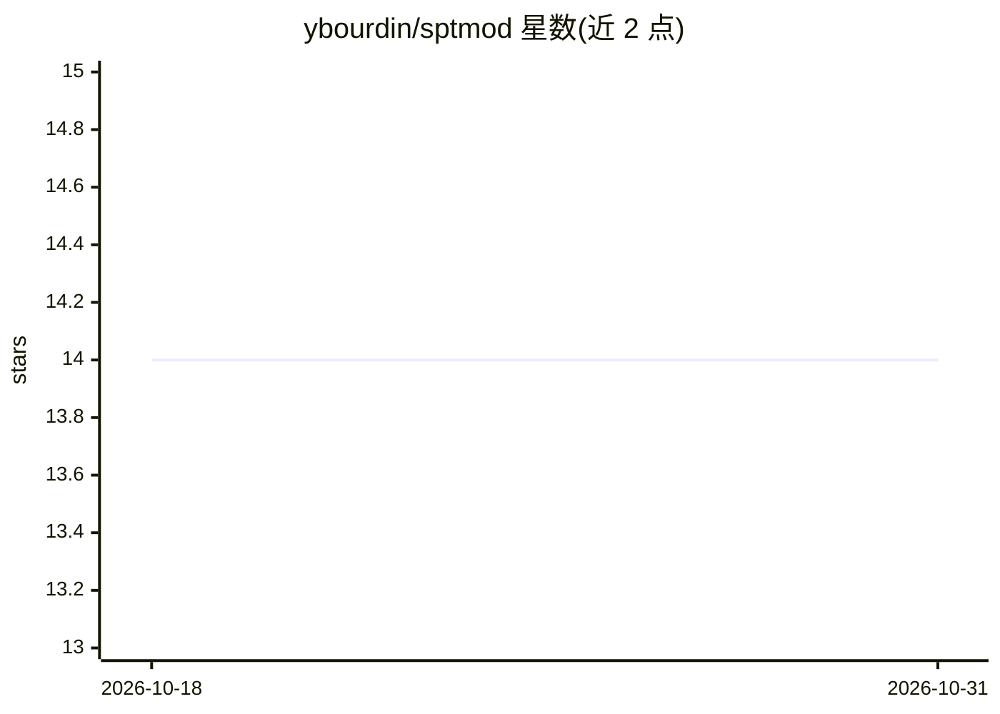

# ybourdin/sptmod

⭐ 14 · Python · 推送 2026-04-23 · [GitHub](https://github.com/ybourdin/sptmod) · [官网](https://ybourdin.github.io/sptmod/) · 个人维护

**动态范围压缩建模的 PyTorch 深度学习模型（DAFx25 论文代码）**

DAFx 2025 论文《Empirical Results for Adjusting Truncated Backpropagation Through Time while Training Neural Audio Effects》的官方 PyTorch 实现。SPTMod 架构包含调制路径与音频路径：调制路径由调制块序列计算作用于音频张量的调制张量，循环层初始状态由状态预测网络（SPN）计算。README 详述基于截断 BPTT 的训练流程与切片索引/裁剪尺寸的数学推导。供神经音频效果研究与复现使用；仓库未给出安装命令。

## 筛选速览

| 维度 | 判定 | 备注 |
|---|---|---|
| AI 角色 | `ai-native` | 本体是模型或模型工具 |
| 许可风险 | `none` | — |
| 部署形态 | `None` |  |
| 模型依赖 | — | README 未给出锁定关系 |
| 硬件要求 | — | 无带数字的原话,不猜 |
| 安装摩擦 | `low` | 无编译、无系统依赖或容器化 |
| 成熟度 | — | 结构信号不足 |

## 能力要点

- SPTMod 双路径架构：调制路径生成调制张量作用于音频路径
- SPN（State Prediction Network）计算循环层初始状态
- 基于 TBPTT 的训练流程（状态缓存、梯度截断、子序列切分）
- 给出切片索引与裁剪尺寸的完整数学推导及实现方法

## 适用场景

- 复现 DAFx25 论文的神经压缩器训练实验
- 研究截断 BPTT 长度调整对神经音频效果训练的影响
- 作为动态范围压缩建模的模型实现参考

## 场景标签

 · 领域:音频信号处理/神经音频效果

## 证据(README 行号)

> L3: This repository contains the PyTorch implementation of SPTMod used for the DAFx25 paper *Empirical Results for Adjus
> L12: *Figure 1*. SPTMod, on the right, consists in two paths called the modulation and audio paths. The modulation path 

## 星数曲线

2026-10-18 14 → 2026-10-31 14（+0）

---
*卡片 v1 · prompt 1.4 · 生成 2026-10-31 · 置信度 high · 依据 README sha `822c75fa3eb7` · [字段定义](../../DATASET.md)*
