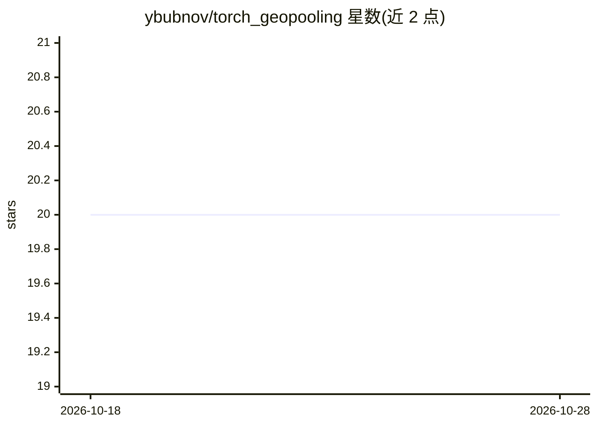

# ybubnov/torch_geopooling

⭐ 20 · C++ · GPL-3.0 · 推送 2026-04-01 · [GitHub](https://github.com/ybubnov/torch_geopooling) · [官网](https://torch-geopooling.readthedocs.io) · 个人维护

**PyTorch 地理空间池化扩展库：提供构建地理空间神经网络的额外层**

Torch Geopooling 是 PyTorch 的扩展库，为构建地理空间神经网络提供额外的神经网络层模块。核心机制是对二维空间中点坐标做分解（quad 矩形分割）：AdaptiveQuadPool2d 在训练过程中自适应构建稀疏分解，QuadPool2d 需预先计算密集（规则）分解，另有用于球面数据学习的 Embedding2d 模块。模块接口与 PyTorch 兼容，支持自动梯度计算，支持 EPSG:4326 坐标与任意多边形输入。以 PyPI 包形式分发，GPLv3 许可。

## 筛选速览

| 维度 | 判定 | 备注 |
|---|---|---|
| AI 角色 | `ai-ecosystem` | LLM/agent 周边工具 |
| 许可风险 | `viral` | GPL-3.0 |
| 部署形态 | `library` | 以包/库形式分发 |
| 模型依赖 | — | README 未给出锁定关系 |
| 硬件要求 | — | 无带数字的原话,不猜 |
| 安装摩擦 | `low` | 无编译、无系统依赖或容器化 |
| 成熟度 | — | 结构信号不足 |

## 能力要点

- AdaptiveQuadPool2d 训练期间自适应构建稀疏四叉树分解
- QuadPool2d 支持任意多边形的预先密集分解
- Embedding2d 二维嵌入模块用于球面数据学习
- 接口与 PyTorch 兼容，支持自动梯度计算

## 适用场景

- 训练预测地理空间特征的神经网络
- 对 GPS 点等二维坐标数据做空间池化与分解
- 为地理数据构建带空间索引的 PyTorch 模型

## 场景标签

 · 领域:地理空间机器学习

## 证据(README 行号)

> L3: The Torch Geopooling library is an extension for PyTorch library that provide extra layers for
> L4: building geospatial neural networks.

## 星数曲线

2026-10-18 20 → 2026-10-28 20（+0）

---
*卡片 v1 · prompt 1.4 · 生成 2026-10-28 · 置信度 high · 依据 README sha `447d002e2bbb` · [字段定义](../../DATASET.md)*
