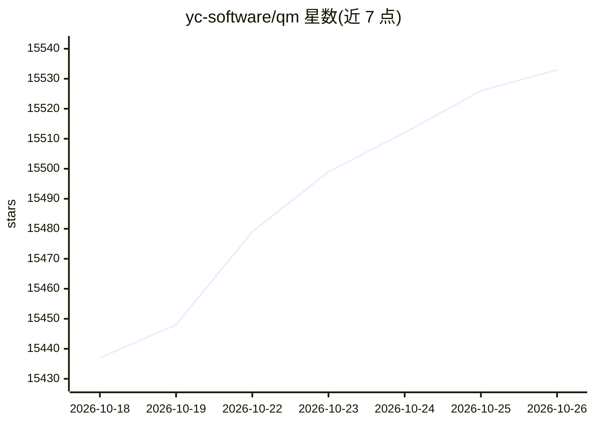

# yc-software/qm

⭐ 15,533 · TypeScript · MIT · 推送 2026-10-25 · [GitHub](https://github.com/yc-software/qm) · [官网](https://x.com/qm__dev) · 组织维护

**企业级多人共享 agent 运行框架，部署在自有云上，Slack 与网页使用**

QM 是面向初创公司的多人 agent 运行框架：每位员工获得隔离工作区（独立记忆、文件、密钥视图、权限、定时任务、沙箱），同时可在 Slack 频道、群消息和项目中协作使用。核心以 TypeScript 运行在 Node 上，用 Postgres 持久化会话与状态，agent 通过固定工具面中的 execute 在持久沙箱执行命令。harness、模型、会话存储、沙箱、记忆均藏在接口之后可替换，部署配置集中在部署目录，由 qm CLI 校验并部署到运营者自己的云账户。提供 Strict/Auto/Dangerous 三档安全姿态与内容筛查、审计。

## 筛选速览

| 维度 | 判定 | 备注 |
|---|---|---|
| AI 角色 | `ai-native` | 本体是模型或模型工具 |
| 许可风险 | `permissive` | MIT |
| 部署形态 | `library` | 以包/库形式分发 |
| 模型依赖 | — | README 未给出锁定关系 |
| 硬件要求 | — | 无带数字的原话,不猜 |
| 安装摩擦 | `low` | 无编译、无系统依赖或容器化 |
| 成熟度 | — | 结构信号不足 |

## 动量与使用信号

- 维护:`active` — 距上次 push 1.1 天,年发版 22,21 位贡献者
- 涨星:近 1 天 **+11**(自 20261016 起算)
- 平台:WEB · 协议:—

## 能力要点

- 个人与共享双作用域：每人和每个房间有独立的记忆、文件、权限与沙箱
- harness 与模型可插拔，Pi 和 Claude Code 驱动同一核心
- Strict/Auto/Dangerous 三档工具调用审批姿态与内容筛查、审计日志
- 支持定时任务、监听与入站 webhook 等后台工作

## 适用场景

- 让全公司员工在 Slack 里共享使用一个可协作的 agent
- 在自有云账户中用自选模型部署企业内部 agent
- 让 agent 检索内部笔记、邮件、数据库并按计划处理收件箱
- 让 agent 在已有仓库中跑测试、开 PR、监控 CI

## 场景标签

`编码 Agent` `Agent 框架` · 领域:Agent 开发

## 证据(README 行号)

> L3: **A multiplayer agent harness for work. In Slack and on the web.**
> L74: Every turn runs through a central core, which can use a variety of models and harnesses
> L89: `qm` CLI validates and deploys. Every substrate (harness, session

## 星数曲线

2026-10-18 15,437 → 2026-10-26 15,533（+96）

---
*卡片 v1 · prompt 1.4 · 生成 2026-10-18 · 置信度 high · 依据 README sha `088e850bb9ed` · [字段定义](../../DATASET.md)*
