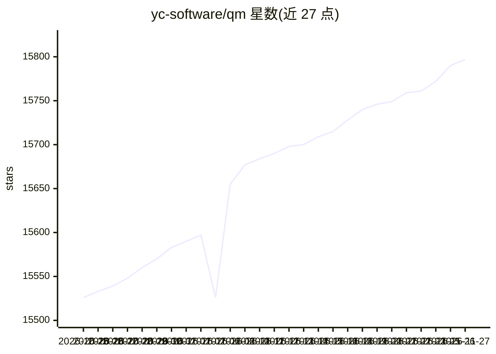

# yc-software/qm

⭐ 15,797 · TypeScript · MIT · 推送 2026-11-26 · [GitHub](https://github.com/yc-software/qm) · [官网](https://labs.ycombinator.com/qm) · 组织维护

**团队多用户 agent 运行平台：Slack/Web 自托管部署**

QM 是面向团队的多用户 agent harness，可部署在自有云上并使用自有模型与密钥。每个人和房间拥有隔离的工作区，包含各自的记忆、文件、密钥视图、权限、定时任务与持久沙箱；同一身份与配置在 Slack 与 Web 间互通。核心为 TypeScript/Node 服务，依赖 Postgres 持久化，agent 通过固定的工具面（含 execute 在隔离沙箱中执行命令）工作，支持 cron、webhook 等后台任务。组织级提供三种安全姿态与命令策略、内容筛查配置，通过 qm CLI 初始化并部署到 AWS/Render/Fly 等目标。

## 筛选速览

| 维度 | 判定 | 备注 |
|---|---|---|
| AI 角色 | `ai-ecosystem` | LLM/agent 周边工具 |
| 许可风险 | `permissive` | MIT |
| 部署形态 | `library` | 以包/库形式分发 |
| 模型依赖 | — | README 未给出锁定关系 |
| 硬件要求 | — | 无带数字的原话,不猜 |
| 安装摩擦 | `low` | 无编译、无系统依赖或容器化 |
| 成熟度 | — | 结构信号不足 |

## 动量与使用信号

- 维护:`active` — 距上次 push 1.1 天,年发版 22,21 位贡献者
- 涨星:近 1 天 **+11**(自 20261016 起算)
- 平台:WEB · 协议:—

## 能力要点

- 个人与共享作用域隔离：记忆、文件、权限、沙箱按 scope 划分
- Slack 与 Web 双入口，同一身份与配置互通
- 三种安全姿态（Strict/Auto/Dangerous）与命令策略、内容筛查
- qm CLI 部署目录机制，支持 AWS/Render/Fly 目标与源码 fork 定制

## 适用场景

- 团队在共享频道中与 agent 协作处理项目跟进
- 让 agent 定时检索内部笔记、邮件、数据库并整理收件箱
- 在现有代码仓库中跑测试、开 PR、监控 CI
- 自托管部署并统一管理组织可用的模型与安全策略

## 场景标签

`AI 助手` · 领域:对话与助手

## 证据(README 行号)

> L3: **A multiplayer agent harness for teams. In Slack and on the web.**
> L81: Every turn runs through a central core, which can use a variety of models

## 星数曲线

2026-10-25 15,526 → 2026-11-27 15,797（+271）

---
*卡片 v1 · prompt 1.4 · 生成 2026-11-22 · 置信度 high · 依据 README sha `119d7f24006d` · [字段定义](../../DATASET.md)*
