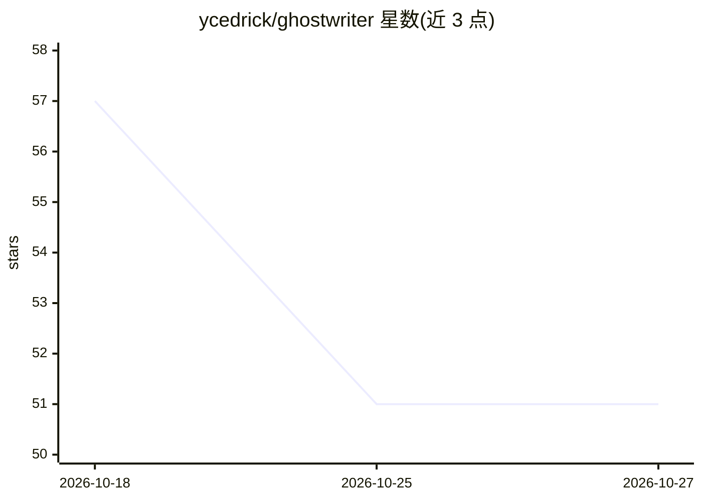

# ycedrick/ghostwriter

⭐ 51 · TypeScript · MIT · 推送 2026-04-17 · [GitHub](https://github.com/ycedrick/ghostwriter) · 个人维护

**面向 AI 编程代理的 AST 代码裁剪工具，压缩大文件上下文**

基于 AST 的代码缩减工具，供终端编程代理在调试与分析大文件时使用：从栈追踪或剪贴板自动定位目标文件与行号，裁剪无关函数/类体，只保留与故障相关的代码块，直接在原文件上工作，不生成临时复现脚本。提供 Gemini CLI 扩展安装与 Codex 插件/技能两种接入方式；README 给出不同文件类型的缩减比例（约 55%-92%）与 40%-90%+ 的代码缩减声明，以降低 API 成本、应对超出上下文限制的大文件。

## 筛选速览

| 维度 | 判定 | 备注 |
|---|---|---|
| AI 角色 | `ai-ecosystem` | LLM/agent 周边工具 |
| 许可风险 | `permissive` | MIT |
| 部署形态 | `None` |  |
| 模型依赖 | — | README 未给出锁定关系 |
| 硬件要求 | — | 无带数字的原话,不猜 |
| 安装摩擦 | `low` | 无编译、无系统依赖或容器化 |
| 成熟度 | — | 结构信号不足 |

## 能力要点

- AST 级代码裁剪，省略无关函数与类体
- 从终端栈追踪或系统剪贴板自动定位错误文件与行号
- 零临时文件调试，直接在原源文件上解析
- Gemini CLI 扩展与 Codex 插件/技能双通道接入

## 适用场景

- 让 AI 代理在超大文件中只读与报错相关的代码以省 token
- 从崩溃栈自动定位并修复错误
- 分析超出模型上下文限制的大型模块

## 场景标签

`编码 Agent` · 领域:编码与开发

## 证据(README 行号)

> L3: GhostWriter is an AST-based code reduction tool for AI coding agents. It streamlines error resolution by isolating b
> L13: GhostWriter is designed to be used seamlessly within terminal-based coding agents:

## 星数曲线

2026-10-18 57 → 2026-10-27 51（-6）

---
*卡片 v1 · prompt 1.4 · 生成 2026-10-24 · 置信度 high · 依据 README sha `7f32cc1984a5` · [字段定义](../../DATASET.md)*
