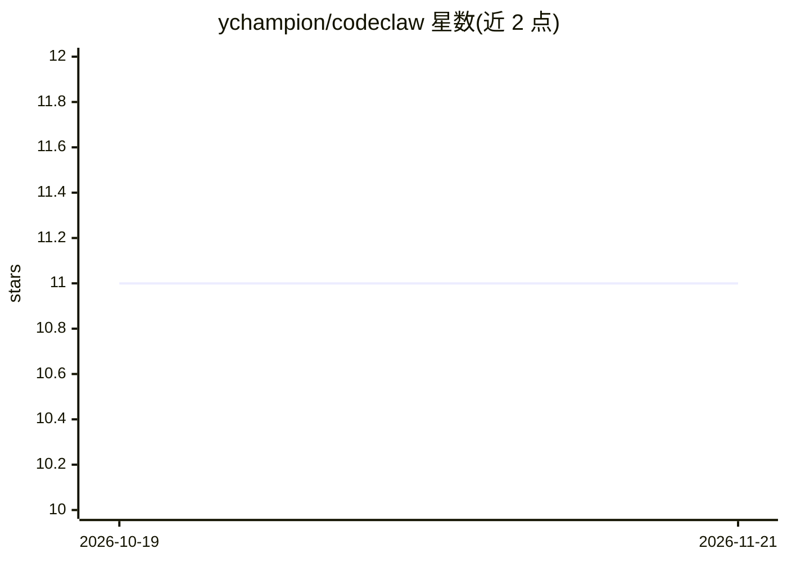

# ychampion/codeclaw

⭐ 11 · Python · MIT · 推送 2026-02-26 · [GitHub](https://github.com/ychampion/codeclaw) · [官网](https://github.com/ychampion/codeclaw/releases) · 个人维护

**给开发者的 Claude Code/Codex 会话导出与数据集构建 CLI**

Python CLI 工具，将 Claude Code 与 Codex 会话转换为隐私安全的训练数据集：解析会话日志，执行密钥/PII 脱敏与用户名匿名化，经本地导出、人工确认与发布声明门控后才推送至 Hugging Face。提供全屏 TUI、后台增量同步守护进程、加密存储，以及可注册到 Claude 配置的 MCP 记忆服务器（会话检索、模式统计、相似会话查找）。ML NER 脱敏、MCP、微调脚手架均为可选依赖；README 提示自动脱敏并非完备，发布前需人工审查。

## 筛选速览

| 维度 | 判定 | 备注 |
|---|---|---|
| AI 角色 | `ai-ecosystem` | LLM/agent 周边工具 |
| 许可风险 | `permissive` | MIT |
| 部署形态 | `library` | 以包/库形式分发 |
| 模型依赖 | — | README 未给出锁定关系 |
| 硬件要求 | — | 无带数字的原话,不猜 |
| 安装摩擦 | `low` | 无编译、无系统依赖或容器化 |
| 成熟度 | — | 结构信号不足 |

## 能力要点

- 多源会话摄取：Claude Code/Codex 原生解析，Cursor、Windsurf、Aider 等适配器为实验性支持
- 隐私导出：正则基线 + 可选 Presidio/spaCy ML NER，用户名匿名化与项目级排除
- 发布前审查门控：本地导出、确认门、发布声明，发布时生成不可变版本快照与去重索引
- MCP 记忆服务器：会话搜索、轨迹统计、图相似度检索

## 适用场景

- 把日常 AI 编程会话整理成可复用的微调数据集
- 脱敏后向 Hugging Face 发布会话数据集
- 通过 MCP 在 Claude 中检索历史解题会话

## 场景标签

`微调` · 领域:训练与推理

## 证据(README 行号)

> L3: CodeClaw converts Claude Code and Codex sessions into privacy-safe training datasets with review gates, background s
> L31: - Multi-source ingestion:
> L45: ## Install

## 星数曲线

2026-10-19 11 → 2026-11-21 11（+0）

---
*卡片 v1 · prompt 1.4 · 生成 2026-11-18 · 置信度 high · 依据 README sha `269bb76498d8` · [字段定义](../../DATASET.md)*
